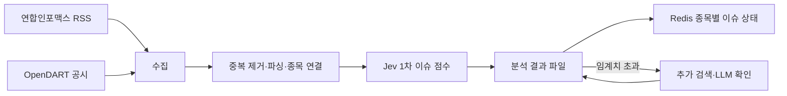

# ADR-0002: RSS 기반 뉴스 수집과 2단계 이슈 분석

- 상태: **설계 채택, 장중 품질·이용 범위 검증 전**
- 결정일: 2026-10-26
- 범위: 개인용 Auto-helm의 뉴스 사건 분석. 공시는 OpenDART를 유지한다.
- 선행 결정: [ADR-0001](0001-event-data-sources.md)의 GDELT 탐색 실험은 이 결정으로 대체하지 않고 해외 뉴스 보조 경로로 유지한다. 국내 뉴스의 첫 시험 경로와 분석 순서는 이 문서를 따른다.

## 결정

국내 금융 뉴스는 연합인포맥스의 [공식 RSS 목록](https://news.einfomax.co.kr/rssIndex.html) 중 `증권`, `IB/기업`을 우선 시험한다. RSS를 3분마다 폴링해 새 기사를 발견하고, 필요하면 `정책/금융`을 별도 피드로 추가한다. 이는 **조회 시도 간격**이며 기사 발행부터 피드 반영까지의 지연을 보장하지 않는다. 현재 관측된 피드는 카테고리별 최신 20건, 전체 기사 최신 50건이다. 매 주기 직전 조회와 겹치는 기사가 있는지 확인하고 새 기사 수가 피드 한도에 닿으면 누락 가능성을 기록한다. 인기 기사는 관심도의 참고 입력일 뿐 새 기사 발견의 기준으로 삼지 않는다.

처리 순서는 다음과 같다.

1. **수집:** RSS XML과 OpenDART 공시를 각각 별도 어댑터로 받는다. 새 뉴스의 발행 시각, 최초 수신 시각, 제공처와 피드명을 구분한다.
2. **중복 제거·파싱·종목 연결:** RSS `nsid`를 우선 사건 키로 쓰고, 없으면 정규화한 기사 URL 해시를 쓴다. 제목은 고유 키로 쓰지 않는다. 동일 기사가 여러 피드에 있으면 사건 하나에 피드 출처와 관련 종목을 추가한다. 종목명·별칭·종목코드 매핑의 신뢰도를 남기고, 연결이 불확실하면 매매 입력에서 제외한다.
3. **Jev 이슈 점수:** 새 사건과 연결 종목을 비동기 작업으로 평가한다. 입력은 해당 제공처가 전달한 제목·발췌문과 시점 정보로 제한한다. 모델/프롬프트/점수 정책 버전, 입력 해시, 방향·강도·관련성·근거와 완료 시각을 결과에 붙인다. 점수의 수치 범위와 임계치는 dev 데이터로 보정해 버전 있는 정책으로 확정한다.
4. **두 갈래 결과:** (a) 1차 점수를 내구성 있는 분석 기록에 먼저 남기고 종목별 Redis 조회 모델에 바로 투영한다. (b) 점수가 임계치를 넘으면 같은 사건·종목·정책 버전으로 중복되지 않는 **추가 검색 작업**을 발행한다. 검색·LLM은 시세 WebSocket, RSS 폴링, 1분 예측을 기다리게 하지 않는다. 확인한 근거와 보정 점수를 새 분석 버전으로 기록한 뒤 Redis를 갱신한다. 실패·시간 초과 시 1차 점수를 지우지 않고 확인 실패를 표시한다.

## 상태와 판단 경계

`SCORED`는 1차 점수가 기록·게시된 상태다. 임계치 초과 시 `SEARCH_PENDING`, 성공 시 `VERIFIED`, 실패 시 `SEARCH_FAILED`를 추가한다. Redis는 상태와 점수 버전을 함께 제공한다. 판단기는 분석 완료 시각이 판단 시각 이전인지, 종목 연결·신선도·상태가 현재 정책에서 허용되는지 확인한다. **확인 대기 중인 1차 점수를 확정된 뉴스 사실로 취급하거나 AI 점수만으로 주문하지 않는다.** 추가 결과는 완료 이후 판단에만 반영하며 과거 스냅샷을 바꾸지 않는다.

검색 호출은 사건·종목·정책 버전별로 한 번의 성공 결과를 재사용한다. 같은 이슈의 여러 기사가 한꺼번에 들어오면 이슈 묶음 단위로 검색을 합치고, 환경별 동시 실행·일일 비용 한도를 둔다. 확인 결과에는 인용 가능한 원문 링크와 확인 시각을 남기며, 근거 부족·상충·검색 실패를 별도 상태로 둔다.

## 기록과 이용 범위

공시 ZIP과 기존 사건 파일이 내구성 있는 원본 기록이다. RSS 기사 전문은 제공되지 않는다. RSS에서 받은 원문 텍스트를 장기 데이터셋이나 안드로이드 조회 사본으로 복제하는 기능은 범위에 넣지 않는다. 파일에는 사건 식별자·출처·시각·종목 연결과 점수·상태·근거 참조를 남기고, 짧은 운영 캐시의 원문 발췌문은 보존 기간을 별도 설정한다. Redis는 파일 기록에서 복원 가능한 조회 사본이다.

연합인포맥스의 [RSS 안내](https://news.einfomax.co.kr/rssIndex.html)는 수집 경로를 공개하지만 [저작권 정책](https://news.einfomax.co.kr/com/copyright.html)은 저작물의 무단 복제·변형 등을 제한한다. **개인용 비공개 시험을 진행하면서** 기사 재게시, 원문 대량 보관, 발췌문의 외부 LLM 전송은 별도 이용 범위를 확인하기 전까지 수행하지 않는다. 추가 검색은 우선 종목·사건 유형·원문 URL 등 최소 식별 정보로 요청하고, 검색 제공처의 응답 이용 조건도 따른다. Jev 호출이 외부 서비스라면 발췌문 전달 범위를 구현 전에 별도 확인한다.

## 검증과 재검토

- 장중 3거래일 이상 기사 발행→RSS 수신 지연, RSS 수신→점수 게시 지연, 피드별 신규 건수와 20건 제한에 따른 누락을 측정한다.
- 종목 연결의 오탐·누락, 중복 기사 비율, Jev 점수와 이후 가격·공시의 관계를 수작업 표본과 비교한다. 점수 임계치는 이 결과와 검색 호출 예산으로 정한다.
- Redis 재시작과 Jev·LLM 장애에서도 기록된 1차 점수와 상태를 복원하고 1분 가격 처리에 영향이 없는지 확인한다.
- RSS의 발견 지연·포괄성이 전략에 부족하거나 필요한 분석 입력을 적법하게 확보할 수 없으면 유료 뉴스 API를 다시 비교한다.

현재 구현에는 RSS 어댑터, Jev 점수 작업자, 검색·LLM 확인 작업자, 점수의 Redis 투영이 없다. 이 ADR은 구현 완료 선언이 아니다.
