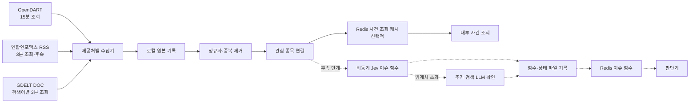
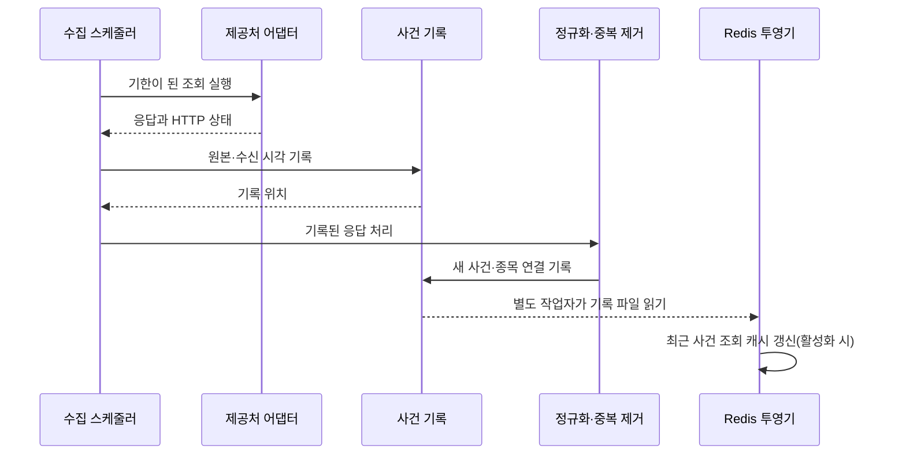

# Event Data 상세 설계 (LLD)

> 상태: 수집과 사건 조회 캐시 구현, AI 분석 미구현 · 2026-10-26
>
> 범위: OpenDART 공시 수집, 연합인포맥스 RSS 국내 뉴스 시험, GDELT 해외 메타데이터 실험, Jev 점수·추가 검색의 비동기 설계. 주문 실행은 포함하지 않는다.
>
> 관련 요구사항: [PRD](../prd/PRD.md) R2·R4·R5 / [HLD](../hld/HLD.md) 4.2·4.3·5.1장 / [ADR-0001](../adr/0001-event-data-sources.md) / [ADR-0002](../adr/0002-event-issue-scoring.md)

## 1. 이 컴포넌트가 하는 일

관심 종목의 공시와 뉴스 후보를 주기적으로 발견한다. **현재 구현은 OpenDART/GDELT 수집 → 원본 기록 → 중복 제거 → 종목 연결 → 선택적 Redis 사건 조회 캐시**까지다. 국내 RSS 수집, Jev 점수, 추가 검색·LLM 분석, 점수의 Redis 투영과 판단기 전달은 아직 설계 단계다. 사건 수집은 별도 프로세스에서 실행되므로 시세 WebSocket과 1분 가격 예측은 사건 조회를 기다리지 않는다.

공시와 뉴스 후보의 사용 범위는 다르다. OpenDART는 공시 목록과 새 접수번호의 원본 서류를 수집한다. GDELT는 **기사 제목·URL·제공처 확인 시각**을 사건으로 기록한다. 연합인포맥스 RSS는 국내 뉴스의 공식 발행 피드에서 제목·링크·발행 시각·짧은 설명을 받는 첫 시험 경로다. RSS에는 기사 전문이 없다. 종목 관련성·발견 지연·분석 입력 범위를 확인하기 전에는 뉴스 점수를 매매 판단 입력으로 활성화하지 않는다. [ADR-0002](../adr/0002-event-issue-scoring.md)

최종 뉴스 경로의 요구는 관심 종목의 **새 기사 또는 이슈를 장중 빠르게 발견하는 것**이다. 국내 RSS를 먼저 측정하고 부족하면 본문·스트림 제공 API를 재평가한다. GDELT는 해외 뉴스의 보조 탐색 실험이다. 시세 급변은 별도의 `원인 미확인 시세 이상`으로 먼저 기록하고, 뉴스·공시가 확인되면 연결한다. 이 흐름은 아직 구현 전이다.

## 2. 수집 주기와 호출 경계

| 경로 | 시작 주기 | 요청 범위와 중복 키 | 장애 시 처리 |
| --- | --- | --- | --- |
| OpenDART `list.json` | 종목별 15분마다 | 어제·오늘 목록을 끝 페이지까지 조회. `rcept_no`로 중복 제거 | 제한 코드 `020`이면 다음 시도를 15분 뒤로 미룬다. 일반 오류는 다음 주기에 재시도한다. |
| OpenDART `document.xml` | 새 접수번호 발견 시 | 새 `rcept_no`만 원본 ZIP 요청 | 현재는 ZIP 저장에 실패하면 사건을 기록하지 않고 다음 목록 조회에서 다시 시도한다. 별도 미완료 작업 기록은 없다. |
| 연합인포맥스 RSS | 피드별 **3분마다 시험 조회** | 증권·IB/기업의 최신 20건을 겹쳐 조회. `nsid` 우선, 없으면 URL 해시로 중복 제거 | 일시 실패·차단 응답은 지수 대기. 빈 피드와 조회 실패를 구별하고, 피드 한도를 넘어선 누락 가능성을 기록한다. |
| GDELT DOC `artlist` | **검색어별 3분마다** | 최근 1시간을 겹쳐 조회. 정규화 URL로 중복 제거 | 전체 GDELT 요청 사이 최소 10초. 429에서는 `Retry-After` 또는 1→2→4→최대 15분 대기. |

GDELT 검색어가 여럿이면 하나의 전역 요청 스케줄러가 순서대로 보낸다. 3분 안에 모두 처리하지 못하면 요청을 동시에 보내지 않고 남은 검색어의 실행 시각을 늦춘다. RSS도 3분은 **조회 시도 간격**이지 새 기사가 3분 안에 제공된다는 보장이 아니다. GDELT 2.0 데이터는 15분 단위로 갱신될 수 있어 연속 조회가 같은 결과를 반환할 수 있다. [GDELT 데이터 안내](https://gdeltproject.org/data.html)

OpenDART의 `rcept_dt`는 날짜 필드다. 분·초 단위의 공개 시각으로 사용하지 않고, `firstSeenAt`을 별도로 남긴다. 현재 목록은 매번 어제·오늘을 다시 조회한다. 수집기는 **장외에도 같은 간격으로 실행**되며, 거래일 달력에 따른 기동·조회 제한은 아직 구현 전이다.

## 3. 한 건을 처리하는 순서

1. **조회:** 제공처 어댑터가 응답 상태·수신 시각을 붙인다. 응답이 비어 있으면 “새 사건 없음”과 “조회 실패”를 구분한다.
2. **원본 기록:** 현재는 공시 목록 응답 또는 GDELT 메타데이터 응답을 환경별 파일에 기록한다. RSS는 허용된 메타데이터와 짧은 운영 캐시만 기록하는 별도 정책을 적용한다. 기록이 실패한 응답을 처리 완료로 표시하지 않는다.
3. **정규화:** 제공처별 필드를 `EventRecord`로 바꾼다. 필수 접수번호·제목 또는 기사 URL·제목이 없으면 사건 기록 대상에서 제외한다.
4. **중복 제거·종목 연결:** OpenDART는 접수번호, GDELT는 정규화 URL, RSS는 `nsid` 우선·URL 해시 대체값으로 이미 본 사건인지 확인한다. 같은 기사가 여러 피드·검색어에 걸리면 사건 하나에 출처와 종목 연결만 추가한다. 제목은 중복 키로 쓰지 않는다. URL 정규화는 확인된 추적 파라미터만 제거하며 기사 식별에 필요한 경로·쿼리는 유지한다. 종목명·별칭 매칭의 신뢰도를 기록한다.
5. **내용 확보:** 새 공시는 원본 ZIP을 받은 뒤 파일에 저장한다. ZIP 다운로드가 실패하면 현재는 사건 기록을 보류하고 다음 목록 조회에서 다시 시도한다. GDELT와 RSS는 기사 본문을 받지 않는다.
6. **1차 점수(후속):** 종목 연결이 확인된 새 사건을 Jev 작업자에 전달한다. 점수·방향·관련성·모델 버전과 완료 시각을 파일에 기록한 뒤 Redis에 게시한다.
7. **선별 검색(후속):** 버전 있는 임계치를 넘으면 중복되지 않는 검색·LLM 작업을 발행한다. 완료·실패 결과를 기록하고 Redis 상태를 갱신한다. 시세·예측·수집 작업은 이 검색을 기다리지 않는다.
8. **조회 캐시:** 현재는 설정을 켜면 별도 작업자가 사건·종목 연결 파일을 읽어 Redis 조회용 사본을 만든다. 점수 투영은 후속 단계다.

분석 작업 생성과 결과 발행은 후속 단계다. 사건·점수 기록이 내구성 있는 원본이며 Redis 투영은 파일에서 재생성할 수 있다. 외부 호출이 실패해도 이미 기록한 1차 점수는 삭제하지 않는다.

원본 파일 쓰기와 Redis 투영 위치는 한 트랜잭션이 아니다. 따라서 재시작 후 같은 응답을 다시 읽을 수 있다. 현재는 **결정적인 사건 ID와 종목 연결 ID**로 중복 기록을 막고, 캐시 투영 위치는 관련 파일을 읽어 Redis에 반영한 뒤 전진시킨다. 분석 작업 ID는 후속 단계다.

### 구성 요소별 책임

| 구성 요소 | 맡는 일 |
| --- | --- |
| `EventCollector` | 별도 상주 프로세스의 제공처별 조회 시각, GDELT 전역 간격, 지수 대기, 중복 제거 |
| `OpenDartAdapter` | 설정된 기업 고유번호로 목록 페이지·원본 ZIP 조회, 응답을 `EventRecord`로 변환 |
| `GdeltAdapter` | DOC 검색, URL 정규화, 기사 목록을 `EventRecord`로 변환. 언론사 본문 요청은 하지 않음 |
| `RssNewsAdapter`(후속) | 카테고리별 XML 폴링, `nsid`/URL 식별, 발행 시각·짧은 설명 파싱, 피드 포화·지연 관측 |
| `ManagedEventSymbols` | 기본 설정과 컨트롤타워 관심 종목 파일을 합쳐 조회 대상 선택 |
| `EventJournal` | 원본·사건·종목 연결 추가 기록과 재시작 시 ID 복원 |
| `EventCacheProjector` | 기록된 사건·종목 연결로 Redis 조회 모델 생성·복원 |
| `EventCacheQuery` | 종목별 최근 사건을 Redis에서 조회하고 캐시 지연·실패를 판정 |
| `JevIssueWorker`(후속) | 사건·종목별 방향·강도·관련성 점수와 정책/모델 버전 기록 |
| `IssueSearchWorker`(후속) | 임계치 초과 사건만 추가 검색·LLM 확인, 중복 호출과 예산 제한, 근거·실패 기록 |
| `EventHealth` | 마지막 성공 조회, 제한 응답 등 수집 상태를 파일로 제공 |

제공처 응답 구조는 어댑터에만 노출한다. 향후 AI 분석기와 판단기는 제공처별 JSON을 직접 읽지 않는다.

Jev 작업자, 검색 작업자와 분석 결과 저장·조회는 아직 구현하지 않았다.

## 4. 사건 ID, 정정 공시, 분석 상태

| 구분 | 규칙 |
| --- | --- |
| OpenDART 사건 ID | `DART:<rcept_no>`; 동일 접수번호는 한 사건이다. |
| GDELT 사건 ID | `GDELT:<정규화 URL의 SHA-256 해시>`; 현재 URL 정규화 규칙 버전은 별도 기록하지 않는다. |
| RSS 사건 ID(후속) | `EINFOMAX:<nsid>`; `nsid`가 없으면 `EINFOMAX:<정규화 URL의 SHA-256 해시>`. 여러 RSS 피드의 동일 기사는 같은 사건으로 묶는다. |
| 종목 연결 | `(eventId, symbol)`로 관리한다. 동일 기사가 복수 종목에 연결될 수 있다. |
| 1차 분석 작업 ID(후속) | `(environment, eventId, symbol, analysisVersion)`으로 정한다. `analysisVersion`은 입력 정책·Jev 모델·점수 정책 버전을 포함한다. |
| 추가 검색 작업 ID(후속) | `(environment, issueGroupId, searchPolicyVersion)`으로 정해 같은 이슈의 중복 검색을 합친다. |

정정 공시는 **새 접수번호를 가진 새 사건**이다. 원 공시와의 관계를 확인해 `amendsEventId`로 연결하는 기능은 후속 단계다. 제목이 비슷하다는 이유만으로 자동 병합하지 않는다. 기존 공시와 기존 판단 기록도 수정하지 않는다.

다음 상태는 **AI 분석·판단기 연결을 위한 목표 계약**이다. 현재 `EventRecord`에는 분석 상태 필드가 없으며, 공시 ZIP 저장이 끝난 사건만 기록한다.

| 상태 | 의미 | 판단기 사용 |
| --- | --- | --- |
| `DISCOVERED` | 목록 또는 메타데이터를 처음 기록함 | 사용하지 않음 |
| `CONTENT_PENDING` | 공시 원본 다운로드가 아직 끝나지 않음 | 사용하지 않음 |
| `ANALYSIS_PENDING` | 분석 작업이 기록되고 실행 대기 중 | 사용하지 않음 |
| `ANALYSIS_FAILED` | 분석 호출·형식 검증 실패 | 사용하지 않음 |
| `SCORED`(후속) | Jev 1차 점수 기록·Redis 게시 완료, 추가 검색 미대상 | 점수 정책이 검증·허용한 경우에만 사용 |
| `SEARCH_PENDING`(후속) | 임계치 초과 후 추가 검색 대기·진행 중 | 확인 완료로 취급하지 않음 |
| `VERIFIED`(후속) | 추가 검색 결과와 근거로 점수 보정 완료 | 종목 관련성·신선도·정책 통과 시 사용 |
| `SEARCH_FAILED`(후속) | 추가 검색 실패·시간 초과, 1차 점수는 보존 | 확인 완료로 취급하지 않음 |
| `ANALYZED_EXPERIMENTAL` | GDELT 메타데이터 분석 성공, 유효성 검증 전 | 화면에서만 표시 |
| `ANALYZED_ELIGIBLE` | 허용된 입력으로 분석 완료, 종목 관련성·최신성 확인 | 정책에서 허용하면 사용 |
| `NOT_AVAILABLE` | 권한 미확인, 제공처 장애, 미수집 등으로 유효 분석이 없음 | 긍정 신호로 해석하지 않음 |

GDELT 메타데이터만 보고 사건의 방향이나 주가 영향을 확정하지 않는다. RSS의 제목·발췌문도 Jev의 **1차 점수**일 뿐 기사 사실 확인이나 본문 분석의 대체물이 아니다. 공시 분석은 원본 확보와 실제 Jev 입력 범위를 확인한 뒤 연결한다. **Jev·추가 검색 경로는 현재 미구현**이며, 뉴스토어 일반 상품과 네이버 검색 결과는 AI 분석 입력에 사용하지 않는다. [ADR-0001](../adr/0001-event-data-sources.md), [ADR-0002](../adr/0002-event-issue-scoring.md)

성공한 분석은 같은 `analysisVersion`으로 재호출하지 않는다. 모델이나 프롬프트를 바꾼 재분석은 별도 버전과 결과로 남기며, 장중 자동 재분석은 하지 않는다. 실패 작업만 제한된 횟수로 재시도한다. LLM 요청 전에 작업 상태를 확인하고, 응답 시간 초과처럼 실행 여부를 모르는 경우에는 비용 중복 가능성을 기록한다. **외부 모델의 실제 호출이 정확히 한 번이었음을 보장하지는 못하지만, 성공 결과는 한 번만 채택한다.**

한 번의 Jev 작업은 사건과 연결된 종목별 관련성·점수를 구분한다. 나중에 새 관심 종목이 같은 사건에 연결되면 기존 종목 결과를 재사용하지 않고 그 종목에 대해 별도 작업 ID로 평가한다. 관련성이 확인되기 전에는 `UNKNOWN`으로 남겨 판단에 쓰지 않는다. `dev`와 `prd`의 분석 결과는 환경별로 분리한다.

## 5. 저장 위치와 파일 계약

| 위치 | 내용 | 용도 |
| --- | --- | --- |
| Mac 메모리 | 최근 사건·종목 연결 ID, 종목별 다음 조회 시각 | 빠른 중복 검사. 재시작 시 기록에서 복원 |
| 환경별 Redis 사건·점수 캐시 | 종목별 최근 사건 ID·작은 메타데이터; 후속 단계에서 1차/확인 점수와 상태 | 내부 조회용 사본. 원본 저장소가 아님 |
| `data/<환경>/events/health.json` | 수집기 PID·상태 시각, 제공처별 조회·성공·실패·429·새 사건 누계 | Prometheus exporter의 읽기 전용 입력. 원본 사건 저장소가 아님 |
| `data/<환경>/events/raw/<날짜>.jsonl` | 현재 OpenDART/GDELT 응답의 허용된 원본·요청/수신 시각·상태. RSS는 발췌문 장기 보관을 피하는 별도 정책 적용 | 당시 발견 근거와 재생 |
| `data/<환경>/events/disclosures/<rcept_no>.zip` | 새 공시 원본 ZIP | 공시 내용 분석과 감사 추적 |
| `data/<환경>/events/events/<날짜>.jsonl` | 정규화 사건 | 중복 제거·조회 모델 재생 |
| `data/<환경>/events/links/<날짜>.jsonl` | 사건과 관심 종목 연결 | 종목별 조회 모델 재생 |
| `data/<환경>/events/analysis/<날짜>.jsonl`(후속) | Jev 1차 점수, 임계치 판정, 검색 작업·확인 결과·오류·버전·완료 시각 | 작업 복구와 판단 근거 보존 |
| 장후 Parquet(후속) | 권한 범위 안의 사건·분석 결과 사본 | 지연·관련성·성과 평가 |
| AWS DynamoDB(후속) | 최신 사건 요약과 상태만 | 안드로이드 원격 조회. 원본 저장소가 아님 |

OpenDART 원본 ZIP은 본문 분석에 필요한 만큼 보존한다. GDELT 기록은 API가 반환한 메타데이터로 한정한다. RSS 원문 발췌문은 장기 학습 데이터셋이나 AWS 조회 사본에 넣지 않고, 사건 ID·출처·시각·종목 연결과 파생 점수·상태를 영속 기록한다. 제공처별 보존·재배포 조건을 저장 정책으로 관리한다. RSS를 외부 Jev/LLM에 입력하는 경우 그 범위는 별도 확인한다. `dev`와 `prd`는 경로·설정·비밀키·분석 예산을 분리한다. 비밀키와 LLM 요청의 민감한 헤더는 원본 기록에 남기지 않는다.

| 계약 | 반드시 담을 정보 |
| --- | --- |
| `EventRecord` | 사건 ID, 환경, 제공처, 제목, URL, 제공처 확인 시각(있을 때), 최초 발견 시각, 입력 범위, 공시 ZIP 경로(있을 때) |
| `EventLink` | 사건 ID, 종목코드, 최초 연결 시각 |
| `EventAnalysis.v1`(후속) | 작업 ID, 사건 ID, 종목, 환경, 입력 범위·해시, 방향·강도·관련성 점수, 임계치 정책, 1차/확인 상태, 근거 참조, 모델·프롬프트·입력 정책 버전, 요청·완료 시각, 오류 사유 |
| `EventSourceHealth` | 제공처, 마지막 성공 조회·마지막 시도 시각, 제한/오류 상태, 발견 건수 |

현재 GDELT의 `seendate`는 `providerSeenAt`에, 처음 수집한 시각은 `firstSeenAt`에 기록한다. OpenDART의 접수일은 시분초가 없어 `publishedAt`으로 채우지 않는다. 향후 분석을 연결하면 `analysisCompletedAt`을 별도로 기록하고, 분석 전의 과거 판단에 나중에 완료된 결과를 끼워 넣지 않는다.

### Redis 조회 캐시

Redis Streams의 **1분봉 전달**과 사건 데이터의 **조회 캐시**는 역할을 구분한다. 현재는 사건·종목 연결을 파일에 먼저 기록한 뒤 `EventCacheProjector`가 조회용 사본을 갱신한다. 공시 ZIP과 원본 응답은 Redis에 넣지 않는다. 사건 조회 API와 판단기가 아직 구현되지 않아, 캐시를 추가해도 사용자 화면의 조회 속도가 달라지지는 않는다.

| 키 종류 | 내용과 조회 방식 |
| --- | --- |
| `autohelm:<환경>:event:v1:<eventId>` | 사건 ID, 제공처, 제목·URL, 최초 발견 시각, 상태 등 **작은 메타데이터**. 공시 ZIP·기사 본문·원본 응답은 넣지 않는다. |
| `autohelm:<환경>:symbol:v1:<symbol>:recent` | `firstSeenAt` 순으로 정렬한 사건 ID 목록. 종목별 최근 사건 조회에 사용한다. |
| `autohelm:<환경>:symbol:v1:<symbol>:eligible` | `analysisCompletedAt` 순으로 정렬한 사용 가능 분석 ID 목록. 판단 시각 이하만 조회한다. |
| `autohelm:<환경>:analysis:v1:<analysisId>` | 분석 상태, 관련 종목, 완료 시각, 모델·프롬프트 버전, 판단에 필요한 요약과 원본 참조 ID. |
| `autohelm:<환경>:symbol:v1:<symbol>:issue-score`(후속) | 최신 사건별 1차 점수·확인 점수, 방향, 상태, 분석 완료 시각, 정책 버전과 만료 시각. 파일에서 재생성한다. |

종목별 목록은 Redis Sorted Set으로 만들고 시각 범위·건수 제한 조회를 사용한다. 캐시에는 만료·최대 보관 범위를 두며 수치는 실제 사건량과 조회 요구를 측정해 정한다. [Redis Sorted Sets](https://redis.io/docs/latest/develop/data-types/sorted-sets/)

- 사건·종목 연결·1차 점수·추가 검색 결과가 각각 기록된 뒤 해당 ID와 종목의 캐시를 갱신한다. 검색이 진행 중이거나 실패한 사실도 점수와 함께 게시한다. 정정 공시는 별도 ID와 원 공시 관계를 보존한다. 분석 버전이 바뀌면 기존 결과를 덮지 않고 새 버전을 추가한다.
- 캐시 누락 또는 Redis 재시작 시 파일 기록에서 해당 종목의 조회 모델을 재생성한다. 투영 위치를 기록하고, 중간에 실패한 갱신은 재시도한다. 캐시만 성공하고 파일 기록이 실패한 상태를 만들지 않는다.
- 판단기는 캐시의 `analysisCompletedAt <= 판단 시각`, 종목 관련성, 사용 가능 상태, 모델 버전과 최신성 기준을 다시 확인한다. 캐시가 늦었거나 조회에 실패하면 최근 분석이 없다는 사실로 해석하지 않고 `NOT_AVAILABLE`로 표시한다. 과거 판단 재생에는 당시까지 이용 가능했던 기록만 쓴다.
- 조회 지연·적중률, 투영 지연, 재생성 시간, Redis 메모리를 관측한다. 데이터가 적어 캐시가 효과가 없는 경우에도 정확성과 복구 비용을 함께 평가한다.

`dev`와 `prd`는 Redis 인스턴스·인증 정보와 키 영역을 분리한다. 같은 환경 안에서 Stream과 캐시를 함께 운영한다면 캐시 만료·용량 제한이 Stream의 미확인 항목을 제거하지 않도록 메모리 정책과 경보를 분리해 설계한다.

**현재 구현:** `EventCacheProjector`가 사건·종목 연결 JSONL을 별도 스레드에서 읽어 사건 메타데이터와 종목별 최근 목록을 Redis에 만든다. 체크포인트는 `data/<환경>/events/bridge/`에 저장하며, Redis가 비어 있으면 파일에서 재생성한다. `EventCacheQuery`는 조회 시점과 투영기 생존 여부를 확인해 결과 또는 `available=false`를 반환한다. 메타데이터는 30일 보관하며 종목 목록은 30일보다 오래된 항목을 제거한다. 분석 결과, 사용 가능 분석 목록, 외부 조회 API는 아직 구현되지 않았다.

## 6. 실패·복구와 판단기 연결

아래에서 수집·Redis 복구는 현재 동작을, 분석 대기열·LLM·판단기 항목은 후속 설계를 설명한다.

| 상황 | 처리 |
| --- | --- |
| GDELT 429 | 모든 GDELT 질의를 일시 중지하고 `Retry-After`를 우선한다. 없으면 1→2→4→최대 15분 대기하며 상태를 기록한다. |
| RSS 조회 실패·피드 포화 | 정상 조회와 실패를 구별한다. 제한 응답은 대기 시간을 늘리고, 직전 조회와 겹치는 항목이 없거나 새 항목이 피드 한도를 채우면 누락 가능성을 표시한다. |
| OpenDART 제한·페이지 실패 | 완료한 페이지까지만 저장하되 해당 조회 전체를 성공으로 표시하지 않는다. 다음 실행에서 겹치는 범위를 다시 읽는다. |
| 원본 파일 기록 실패 | 사건·분석 작업을 발행하지 않는다. 장애를 드러내고 재조회한다. |
| 공시 원본 ZIP 실패 | 현재는 사건 기록을 보류하고 다음 목록 조회에서 재시도한다. `CONTENT_PENDING` 작업 상태는 아직 없다. |
| 분석 대기열 포화 | 시세 경로는 계속 동작한다. 사건은 기록으로 보존하고 분석 지연을 표시한다. 만료된 작업은 판단기 입력에서 제외한다. |
| Jev 성공·추가 검색 실패 | 1차 점수와 `SEARCH_FAILED`를 보존한다. 확인 점수를 만들어내지 않고 중복 검색 재시도를 제한한다. |
| LLM 오류·응답 시간 초과 | `ANALYSIS_FAILED`와 오류 이유를 기록한다. 제한된 재시도 뒤 중지하며 성공한 결과를 덮어쓰지 않는다. |
| 프로세스 재시작 | 현재는 사건·종목 연결 파일에서 기존 ID를 다시 읽어 중복 기록을 막는다. Redis 투영은 별도 파일 위치부터 재개하거나 Redis 초기화 시 전체를 재생한다. 분석 작업 복구는 후속 단계다. |

판단기는 `EventAnalysis.v1`의 결과뿐 아니라 **분석 완료 시각, 최초 발견 시각, 입력 범위, 1차/확인 상태, 사용 가능 상태**를 함께 확인한다. 임계치 초과 후 `SEARCH_PENDING`이면 확인 완료로 취급하지 않는다. 새 정책상 사용 가능한 결과가 나오면 해당 종목을 현재의 시세·계좌 상태로 재평가한다. 과거 판단을 수정하거나 AI 결과만으로 주문하지 않는다. 뉴스 신호가 없거나 실험 상태이면 `NOT_AVAILABLE`로 취급하며, 부재를 호재로 해석하지 않는다. 사건 신호의 최대 허용 지연은 재생·장중 관찰 후 정책값으로 확정한다.

## 7. 구현 순서와 완료 기준

OpenDART/GDELT 수집·중복 제거와 선택적 Redis 사건 조회 캐시는 구현했다. 아래 RSS·분석 단계와 장중 검증은 아직 남아 있다.

1. OpenDART 키로 1~2개 종목의 기업 고유번호, 목록 페이지, 정정 공시, 원본 ZIP 응답을 확인한다. 외부 AI 입력 허용 범위도 확인한다.
2. 제공처 어댑터와 원본 기록·재생·중복 제거를 구현한다. GDELT는 3분 주기와 전체 10초 간격, 429 대기를 시험한다.
3. RSS 어댑터로 증권·IB/기업 피드를 3분 조회하고, `nsid` 중복 제거·발행/수신 시각·피드 포화를 기록한다. RSS의 짧은 운영 캐시와 영속 메타데이터를 구분한다.
4. 종목 연결 신뢰도, Jev 작업 기록, 비동기 점수 작업자와 분석 파일→Redis 투영을 구현한다. 고정된 시험 응답으로 입력·결과 계약과 복구를 검증한다.
5. 버전 있는 임계치 정책과 중복 제거된 추가 검색·LLM 작업자, 호출 예산·실패 상태를 구현한다. 검색은 1분 예측·RSS 수집과 독립 실행한다.
6. 3거래일 이상 RSS 발견 지연·누락·종목 연결·점수/검색 지연·비용을 관찰한다. GDELT의 해외 뉴스 보조 가치도 따로 검증한다.

완료 기준은 같은 접수번호·RSS `nsid`·URL을 여러 번 조회해도 사건이 중복되지 않고, 정정 공시는 별도 사건으로 남으며, 조회·Jev·LLM 장애가 시세 처리를 막지 않는 것이다. 1차 점수와 검색 결과가 상태·시각·버전과 함께 파일과 Redis에서 일치해야 한다. 재시작 후 미처리 작업만 재개되고, 분석 시각 이후의 판단에서만 유효한 결과를 참조해야 한다. **RSS나 GDELT의 시험 수집만으로 PRD R2의 AI 분석 요구를 완료 처리하지 않는다.**
