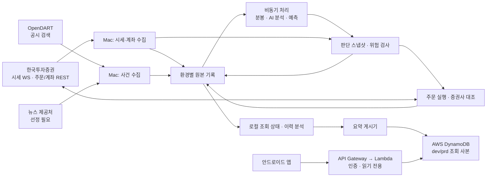

# Auto-helm High-Level Design (HLD)

> 상태: 초안 · 2026-10-26
>
> 기준 문서: [PRD](../prd/PRD.md)

## 1. 설계 범위

이 문서는 한국투자증권 계좌로 KRX·NXT 주식을 관찰하고, 판단을 기록하고, 모의투자 검증 후 실전 거래하는 개인용 시스템의 구성과 데이터 흐름을 정의한다. 제품 목표와 완료 기준은 PRD를 따른다. 주문 기준값, API 세부 필드, 테이블 키와 배포 명령은 후속 상세 설계에서 확정한다.

핵심 설계 원칙은 다음과 같다.

- **시세 수신과 AI 분석은 독립적으로 진행한다.** 느린 뉴스 분석이 다음 1분 가격 처리나 주문 상태 확인을 막지 않는다.
- **판단은 시점이 고정된 입력 묶음으로 만든다.** 당시 사용 가능한 데이터와 버전을 남겨 이후 결과와 비교한다.
- **주문은 별도의 위험 검사와 계좌 대조를 통과한다.** 예측이나 AI 응답이 직접 주문하지 않는다.
- **로컬의 거래 기록이 원본이다.** AWS의 모니터링 데이터는 조회용 사본이며 매매 판단의 필수 입력이 아니다.
- **모의투자와 실전투자는 권한·계좌·데이터를 분리한다.** 검증된 버전만 실전에 배포한다.

## 2. 시스템 경계



Mac은 장중 판단과 주문의 실행 위치다. Mac이 멈추면 신규 판단과 주문도 멈춘다. AWS 경로는 기존 상태를 원격에서 보여주되 마지막 갱신 시각을 함께 제공한다. AWS 장애 때문에 로컬 거래가 막히지 않도록 한다.

## 3. 주요 구성 요소

| 구성 요소 | 책임 | 지연·장애 시 동작 |
| --- | --- | --- |
| 시장 어댑터 | 한투 실시간 체결·호가 수신, KRX/NXT 및 장 구간 구분, 재연결과 누락 감지 | 신선하지 않은 종목의 신규 진입 보류 |
| 계좌 어댑터 | 잔고·미체결·주문·체결 조회, 주문 결과 대조 | 상태가 불명확하면 신규 주문 중지 |
| 사건 수집기 | 공시·뉴스 조회, 종목 연결, 원본 중복 제거, 정정 연결 | 마지막 확인 시각을 표시하고 오래된 신호를 제외 |
| 사건 분석기 | 새 사건의 관련성·방향·근거를 AI로 비동기 분석 | 실패·지연을 기록하며 시세 처리는 계속 |
| 분봉·예측기 | 완료된 1분 가격 데이터 생성, 네 목표 가격의 예측과 사후 비교 | 목표 가격이 유효하지 않으면 예측 사용 불가 표시 |
| 판단기 | 가격·예측·사건·계좌 상태를 시점 기준으로 묶어 매수·매도·대기 결정 | 입력 누락·충돌 시 대기 사유 기록 |
| 위험 검사기 | 시장·계좌·미체결·비용·주문/손실 한도와 중지 상태 검사 | 통과하지 못하면 주문 의도 생성 금지 |
| 주문 실행기 | 주문 의도 기록, 한투 주문·정정·취소, 접수·체결 대조 | 결과 불명확 시 중복 전송 금지 및 주문 중지 |
| 기록·조회기 | 원본 기록 보존, 현재 상태 재구성, 성과 계산 | 조회 인덱스가 손상되면 원본에서 재생성 |
| 모니터링 게시기 | 최신 상태와 중요 사건만 AWS에 비동기 반영 | 게시 실패를 재시도하고 원격 화면에 지연 표시 |

구성 요소는 논리적 책임을 뜻한다. 초기에는 한 Mac에서 실행하되 시세 수신, 분석, 주문 실행은 독립된 작업자와 제한된 대기열로 분리한다. 실제 프로세스 수와 배포 단위는 부하 측정 후 정한다.

## 4. 세 입력 흐름

### 4.1 시세와 계좌

한투 WebSocket에서 관심 종목의 실시간 시세를 받고, 계좌·주문 조회는 REST와 주문/체결 통보를 조합한다. 한국투자증권은 실시간 시세·통보용 WebSocket과 주문·계좌 조회용 REST를 제공한다. **NXT 채널·주문 유형·모의투자 지원 범위는 계좌와 API 명세에서 실제로 확인한 뒤 활성화한다.** [한투 Open API 소개](https://apiportal.koreainvestment.com/about-open-api), [API 문서](https://apiportal.koreainvestment.com/docs)

수신 데이터에는 종목, 시장(KRX/NXT), 장 구간, 제공처 시각, 수신 시각, 출처를 붙인다. 서로 다른 채널에서 같은 거래가 들어올 수 있으므로 원본 식별 기준과 거래량 합산 규칙을 정한다. 종목·시장·장 구간별로 완성된 1분 데이터를 만들고, 지연 또는 누락된 구간은 정상 데이터와 구별한다.

계좌 상태는 장 시작 전, 주문 직전, 주문/체결 통보 후, 장애 복구 후에 갱신한다. 통보와 조회 결과가 어긋나면 증권사 조회를 기준으로 다시 대조한다. 조회가 실패하거나 오래되면 신규 주문을 중지한다.

### 4.2 공시

OpenDART의 공시 검색 API로 새 접수 건을 조회한다. 관심 종목의 종목코드와 DART 고유번호를 연결하고, 접수번호를 중복 제거의 기본 키로 쓴다. 정정·철회 관련 정보는 기존 공시를 덮어쓰지 않고 별도 사건으로 연결한다. 공시 검색 API는 접수번호, 종목코드, 보고서명과 접수일자 등을 제공하며 정정 공시를 포함할 수 있다. [OpenDART 공시 검색](https://opendart.fss.or.kr/guide/detail.do?apiGrpCd=DS001&apiId=2019001), [고유번호](https://opendart.fss.or.kr/guide/detail.do?apiGrpCd=DS001&apiId=2019018)

초기 조회 주기는 **장중 15분**으로 두고, 시작·재시작 시 지난 조회 구간을 겹쳐 다시 읽는다. 접수번호로 중복을 제거해 누락과 중복 분석을 줄인다. 이는 공시를 즉시 반영하는 설계가 아니므로 발견 지연을 기록한다. 전략이 허용하는 공시 지연보다 실제 지연이 크면 해당 사건 신호를 거래 근거에서 제외한다. 제공처의 호출 제한과 실제 응답 지연을 확인해 주기를 조정한다.

### 4.3 일반 뉴스

사용 권한과 원문 접근 범위를 확인한 뉴스 제공처를 선정한다. 초기에는 **1분 주기 조회**를 가정한다. 제공처 ID 또는 정규화한 원문 URL로 중복을 제거하고, 기사 시각·발견 시각·분석 완료 시각을 별도로 남긴다. 종목 관련성이 불확실한 기사는 매매 신호로 사용하지 않는다.

뉴스 제공처가 정해지기 전에는 특정 사이트의 비공식 수집 방식에 의존하지 않는다. 제공처의 지연·호출 한도·원문 사용 조건을 검증한 뒤 주기와 분석 대상을 확정한다.

## 5. 비동기 분석과 판단

### 5.1 작업 흐름

원본 수집기는 확인된 사건을 기록한 뒤 분석 작업을 게시한다. AI 작업자는 시세 작업자와 별개로 새 뉴스·공시만 분석하고, 결과에 원본 ID, 종목, 모델·프롬프트 버전, 완료 시각과 실패 상태를 붙인다. 작업이 중복 실행돼도 같은 원본·분석 버전의 결과는 한 번만 채택한다.

완성된 1분 가격 정보가 나오면 예측기는 **다음 1분, 1시간 뒤, 당일 KRX 공식 종가, NXT 거래 종료 기준 가격**을 갱신한다. 경량 시계열 모델은 `새 1분 데이터 + 이전 상태 → 새 상태 + 예측` 형태로 운용한다. 장 시작 또는 재시작 시 저장된 최근 데이터로 상태를 복원하고, 매분 전체 이력을 다시 입력하지 않는다. 시장이 열리지 않거나 목표 시점의 유효 가격을 정의할 수 없으면 해당 예측은 사용 불가로 표시한다. 장 종료 후 실제 가격과 단순 기준선을 비교한다.

모델 학습은 장중 판단과 분리해 저장된 시계열 데이터로 수행한다. 이전 분봉에서 다음 목표 가격을 맞히도록 학습하고, 거래일·평가 구간의 경계에서 상태를 초기화한다. 시간순으로 학습·검증 구간을 나누고 단순 기준선보다 나은지 확인한 버전만 승격한다. 장중에는 검증되지 않은 새 모델을 자동 적용하지 않는다.

판단기는 완료된 1분 가격 정보와 새 AI 분석 결과를 각각 재평가 계기로 삼는다. **매분 가격 기반 판단은 AI 완료를 기다리지 않는다.** 새 분석이 늦게 도착하면 그 시점의 최신 가격·계좌 상태로 다시 판단하며 과거 판단을 수정하지 않는다. 같은 종목에 재평가가 연속 발생하면 최신 상태를 기준으로 순서대로 처리하고 이미 처리한 판단에서 중복 주문을 만들지 않는다.

### 5.2 판단 스냅샷

매 판단마다 변경 불가능한 스냅샷을 남긴다. 여기에는 환경, 종목·시장, 판단 시각, 참조한 1분 데이터·예측·사건 분석의 ID와 시각, 계좌/미체결 상태, 모델·정책 버전, 예상 거래비용, 위험 검사 결과, 매수·매도·대기와 이유가 포함된다.

판단에 쓸 수 있는 정보는 **판단 시각 이전에 수신·분석 완료된 것**으로 제한한다. 장중에는 메모리의 최신 상태를 조합하되, 확정된 스냅샷과 참조 ID를 원본 기록에 보존한다. 조회 화면은 이 기록을 읽으며, 단일 데이터베이스에 모든 원본을 적재할 필요는 없다.

### 5.3 주문 경계

```text
판단 후보 → 최신 계좌·미체결·시장 재확인 → 위험 검사
          → 주문 의도 영속 기록 → 한투 주문 요청
          → 접수·거부·부분 체결·체결·취소 대조 → 성과 반영
```

주문 의도에는 환경, 판단 ID와 고유 주문 ID를 부여한다. 주문 요청 전에 의도를 내구성 있는 원본 기록에 남긴다. 응답 시간 초과는 실패 확정이 아니다. 동일 주문을 바로 재전송하지 않고 한투의 주문·체결·잔고를 조회해 상태를 확정한다. 상태가 불명확한 동안 신규 주문을 중지한다. 모의투자와 실전투자 모두 같은 안전 절차를 거친다.

## 6. 데이터 저장과 읽기

| 위치 | 저장 내용 | 사용 방식 |
| --- | --- | --- |
| Mac 메모리 | 종목·시장별 최신 시세/분봉, 예측, 유효 사건 신호, 계좌·주문 상태 | 장중 빠른 판단 입력. 재시작 시 원본과 증권사 조회로 복구 |
| 환경별 날짜·종류별 추가 기록 파일(JSONL) | 수신 사건, 분석 결과, 예측, 판단 스냅샷, 주문 의도·상태 변경 | 사실 기록의 원본. 주문 의도는 전송 전 내구성 확보 |
| 환경별 Parquet | 장 마감 후 정리한 분봉·특징·예측/실제·성과 데이터 | 학습, 시간순 검증, 백테스트와 장기 분석 |
| DynamoDB Local (dev) | 조회 모델과 AWS 게시 형식의 개발·테스트 사본 | 개발용. 삭제 후 원본에서 재생성 가능 |
| AWS DynamoDB (dev/prd 분리) | 종목·계좌의 최신 요약과 중요 판단·주문·장애 사건 | 안드로이드 조회용. 로컬 매매의 진실 원본이 아님 |

DynamoDB Local은 AWS가 개발·테스트용으로 제공한다. 로컬 실전 거래의 유일한 저장소로 사용하지 않는다. AWS DynamoDB와 자동 동기화되지 않으므로 요약 게시기가 필요한 항목만 명시적으로 올린다. [DynamoDB Local 안내](https://docs.aws.amazon.com/amazondynamodb/latest/developerguide/DynamoDBLocal.html), [사용상 주의](https://docs.aws.amazon.com/amazondynamodb/latest/developerguide/DynamoDBLocal.UsageNotes.html)

원본 사건에는 공통으로 `event_id`, 환경, 종목·시장, 출처, 제공처 시각, 수신 시각, 기록 시각과 스키마 버전을 둔다. 각 처리기는 마지막으로 반영한 사건 ID를 기록해 재시작 후 미처리 사건을 다시 재생한다. 기록과 조회 사본이 달라지면 원본을 기준으로 조회 사본을 재생성한다.

계좌 정보와 비밀키는 환경별 접근 권한으로 보호한다. 비밀키는 기록 파일·로그·앱으로 보내지 않는다. 원본 기록과 Parquet은 정기적으로 암호화해 별도 위치에 백업하고, 복원 가능 여부를 시험한다.

AWS에는 고빈도 체결 틱이나 원문 전체를 보내지 않는다. 최신 계좌·종목·판단 상태는 주기적 작은 스냅샷으로, 주문·중지·장애는 발생 시 이벤트로 게시한다. 각 항목에 생성 시각과 마지막 성공 게시 시각을 넣어 앱이 오래된 상태를 구별한다. 게시 실패는 로컬 대기열에 남겨 재시도하고, 게시 중단이 매매 경로를 막지 않도록 한다.

## 7. 실행 환경과 원격 조회

Mac에서 **dev와 prd를 별도 실행 단위(파드), 저장 경로, 계정 자격 증명, 설정, 주문 권한**으로 분리한다. dev는 한투 모의계좌만, prd는 검증 후 활성화된 실전 계좌만 사용한다. AWS에도 환경별 테이블·접근 권한·모니터링 API를 분리한다. 코드와 모델은 dev에서 검증한 동일 버전을 prd로 승격하며 실전 기능은 기본 비활성 상태다.

안드로이드 앱은 인증된 HTTPS 요청을 API Gateway에 보내고, 읽기 전용 Lambda가 해당 환경의 DynamoDB 조회 사본만 읽는다. 앱에는 한투·AWS 비밀키를 넣지 않고 주문 API도 제공하지 않는다. AWS의 모바일 백엔드 참조 구조 역시 API Gateway–Lambda–DynamoDB와 인증 계층을 사용한다. [AWS 모바일 백엔드 참조](https://docs.aws.amazon.com/whitepapers/latest/serverless-multi-tier-architectures-api-gateway-lambda/mobile-backend.html)

한투 시세를 앱에 재표시할 수 있는 범위는 서비스 조건을 확인한 후 정한다. 개인의 자기 자산 투자 목적 이용과 제3자 제공 제한이 명시돼 있으므로, 초기 모니터링은 계좌·판단·주문 요약을 우선하고 시세 필드는 허용 범위에 맞춘다. [한투 Open API 이용 안내](https://apiportal.koreainvestment.com/about-open-api)

## 8. 장애 대응과 운영 지표

| 상황 | 자동 동작 | 복구 확인 |
| --- | --- | --- |
| 시세 연결 중단·분봉 누락 | 해당 종목 신규 진입 보류, 마지막 정상 시각 표시 | 재연결·가능한 누락 복구 후 연속성과 시각 확인 |
| AI 지연·실패 | 시세 처리 계속, 사건 신호는 미완료 표시 | 재시도 후 최신 시점에만 반영 |
| 계좌·주문 조회 실패 | 모든 신규 주문 중지 | 증권사 주문·체결·잔고 대조 |
| 주문 응답 불명확·재시작 | 의도와 응답 기록을 남기고 중복 전송 금지 | 증권사 상태 확정 전 거래 재개 금지 |
| Mac 정지·정전 | 신규 판단·주문 중지, AWS 화면은 마지막 게시 시각 표시 | 재시작 시 원본 재생과 계좌 대조; 기존 미체결 주문은 증권사에서 별도 확인 |
| AWS 게시·조회 장애 | 로컬 거래 계속, 게시 작업 재시도 | 누락된 요약 재게시와 앱 갱신 시각 확인 |

장중에는 마지막 시세·계좌 확인 시각, 1분 데이터 완성 지연, 사건 발견·분석 지연, 판단 확정 지연, 주문 중지 사유, 미확정 주문 수, AWS 게시 지연을 기록한다. 허용 지연과 손실 한도는 PRD의 단계 시작 전 확정 항목을 따른다. 모든 중지와 재개는 이유와 시각을 남긴다.

AI 분석은 새롭고 관련성 있는 사건에만 요청하고 중복 원본은 재호출하지 않는다. 모델 호출량과 AWS 저장·조회량을 환경·종목·일자별로 측정해 예산 상한과 경보를 설정한다. 예산을 소진하면 사건 분석을 보류하고 이유를 기록하되 시세·계좌·주문 상태 확인은 계속한다.

Mac이 꺼진 동안 이미 증권사에 접수된 주문은 자동으로 취소된다고 가정하지 않는다. 원격 화면은 마지막 상태만 보여주며, 긴급한 확인·취소는 증권사 공식 앱을 통해 수동으로 수행할 수 있어야 한다.

## 9. 구축 단계와 남은 결정

| 단계 | 우선 구축할 경로 | 다음 단계 진입 확인 |
| --- | --- | --- |
| 관찰 MVP | 시세·사건 수집 → 원본 기록 → 예측·판단 스냅샷 → 로컬 조회 | 정보 시각·누락·재생 결과와 예측/실제 비교 |
| 모의투자 | dev 계좌·주문 실행, 위험 검사, 주문 대조, 성과 계산 | 중복 주문 방지와 사전 정의한 성과·손실 기준 |
| 원격 모니터링 | 요약 게시 → AWS 조회 사본 → 인증된 앱 조회 | 환경 구분, 읽기 전용, 지연 상태 표시 |
| 실전투자 | 검증된 코드·모델 승격, 제한 금액 주문 | 첫 주문·체결·잔고를 증권사와 대조 |

상세 설계 전에 다음을 확인한다.

1. 한투 계좌에서 사용할 KRX·NXT 시세 채널, 모의/실전 주문 유형, 체결 통보와 조회 범위.
2. 뉴스 제공처의 라이선스·지연·호출 한도와 기사 원문 사용 범위.
3. 공시 15분·뉴스 1분 조회가 전략의 허용 지연과 제공처 제한에 맞는지.
4. 네 가격 목표의 거래 시간 경계와 평가 가격 정의, 시계열 모델의 기준선 및 시간순 검증 방법.
5. 장중 메모리/파일 처리량, 원본 기록의 내구성, 백업·복구 시간과 AWS 게시 비용.
6. PRD에서 미정인 정보 최신성·주문/손실 한도·성과 평가 기준.
