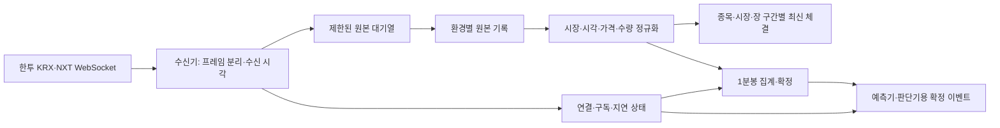

# Market Data 상세 설계 (LLD)

> 상태: 초안 · 2026-10-26
>
> 범위: 관찰 MVP의 국내주식 실시간 시세 수신과 1분봉 생성
>
> 상위 문서: [PRD](../prd/PRD.md) R1·R3·R4·R5, [HLD](../hld/HLD.md) 3·4.1·5·6장

## 1. 목적과 경계

관심 종목의 KRX·NXT 체결 시세를 받아 **출처와 시각을 보존한 1분 데이터**를 만든다. 예측기와 판단기는 이 문서가 발행한 확정 결과만 사용한다. 연결이 끊기거나 데이터의 시장·시각을 확인할 수 없으면 그 이유를 함께 발행해 신규 진입 판단을 보류하게 한다.

이 문서는 계좌·주문, 뉴스·공시, 예측 모델 자체를 설계하지 않는다. 호가는 나중에 거래비용 및 유동성 판단에 필요하므로 수신 계약을 정의하지만, 첫 관찰 MVP의 1분 가격은 **실제 체결 데이터만**으로 만든다. 예상체결과 호가를 체결 가격으로 대체하지 않는다.

## 2. 입력 채널과 구독

한국투자증권 공식 예제에는 KRX 체결 `H0STCNT0`, NXT 체결 `H0NXCNT0`, 통합 체결 `H0UNCNT0` 및 각 시장의 호가 채널이 있다. **초기에는 KRX와 NXT 체결 채널을 별도로 구독**한다. 통합 채널을 동시에 1분봉에 합치면 같은 체결을 중복 계산할 위험이 있으므로 통합 채널은 별도 비교 실험에서만 사용한다. 공식 예제의 TR ID가 실제 계좌·접속 환경에서 수신 가능하다는 뜻은 아니며 연결 시험으로 확인한다. [한투 국내주식 WebSocket 예제](https://github.com/koreainvestment/open-trading-api/blob/main/examples_user/domestic_stock/domestic_stock_functions_ws.py)

| 구독 | 입력 키 | 정규화 시장 | MVP 용도 |
| --- | --- | --- | --- |
| `H0STCNT0` | 관심 종목 코드 | `KRX` | KRX 체결·1분봉 |
| `H0NXCNT0` | 관심 종목 코드 | `NXT` | NXT 체결·1분봉 |
| `H0STASP0`, `H0NXASP0` | 관심 종목 코드 | 각각 `KRX`, `NXT` | 호가 수신 검증 후 최신 호가 상태에만 사용; 1분봉에는 미포함 |

- `dev`와 `prd`는 별도 접속키·설정·원본 경로를 쓴다. 동일 종목을 두 환경에서 구독하더라도 기록을 섞지 않는다.
- 관심 종목 변경 시 현재 구독 집합과 원하는 집합의 차이만 등록·해제한다. 등록 요청의 응답을 확인하기 전에는 해당 종목을 `READY`로 표시하지 않는다.
- WebSocket 승인키 발급, 연결, 응답 해석, 재접속은 시장 어댑터가 담당한다. 공식 예제의 접속 방식과 응답 형식을 기준으로 구현하되 접속 주소·구독 한도·호출 제한은 환경별 설정으로 둔다. 키와 승인 응답은 로그에 기록하지 않는다. [한투 공식 저장소](https://github.com/koreainvestment/open-trading-api)
- 거래일·휴장·시장별 장 구간은 별도 거래 달력/설정에서 받는다. 설정이 없거나 공급자 장 구간 코드의 의미를 확인하지 못한 시간은 `UNKNOWN_SESSION`으로 표시하고 거래 가능 시간으로 간주하지 않는다. 장 시간 숫자를 코드에 박아 넣지 않는다.

## 3. 처리 흐름

수신기는 소켓 읽기를 디스크 기록·분봉 계산·AI 분석 때문에 기다리지 않는다. 제한된 대기열이 차면 오래된 틱을 조용히 버리지 않고 **과부하와 영향받은 종목·시각 구간을 기록**한다. 이후 구간의 1분봉은 불완전으로 확정한다. 원본 기록에 쓰지 못한 틱은 판단 입력에 넣지 않는다.

원본 기록이 성공한 뒤 정규화·집계한다. 원본 기록에는 시세 데이터 프레임과 수신 순서, 연결 세대, 수신 시각, 구독 채널을 남긴다. 한 프레임에 여러 체결이 담기면 각 체결의 프레임 내 위치도 보존한다. 인증·구독 제어 프레임의 비밀값은 저장하지 않는다. 파서가 실패해도 해당 데이터 프레임과 오류 코드를 남겨 재처리할 수 있게 한다.

## 4. 데이터 계약

모든 시각은 저장 시 UTC 시각과 원천의 한국 시간 값을 함께 보존한다. 1분 경계와 거래일은 `Asia/Seoul`로 계산한다. 공급자 시각이 초 단위라면 같은 초에 들어온 틱의 순서는 수신 순서로만 구분한다. 이를 실제 체결 순번이라고 주장하지 않는다.

| 출력 | 필수 필드 | 의미 |
| --- | --- | --- |
| `MarketTick.v1` | `event_id`, `env`, `symbol`, `venue`, `session`, `tr_id`, `source_date`, `source_time`, `received_at`, `recorded_at`, `price`, `trade_volume`, `cumulative_volume`, `connection_epoch`, `receive_seq`, `raw_ref` | 검증을 통과한 단일 체결 관측. 가격·수량은 원문 문자열이 아닌 정수로 정규화 |
| `MinuteBar.v1` | `bar_id`, `env`, `symbol`, `venue`, `session`, `minute_start`, `minute_end`, `open`, `high`, `low`, `close`, `volume`, `trade_count`, `first_tick_id`, `last_tick_id`, `sealed_at`, `quality`, `gap_refs` | `[minute_start, minute_end)` 구간의 체결 집계. 체결이 없는 구간의 OHLC는 `null` |
| `MarketHealth.v1` | `env`, `symbol`, `venue`, `subscription_state`, `last_received_at`, `last_source_time`, `gap_start`, `reason`, `updated_at` | 연결·구독·데이터 최신성 상태. 종목별 현재 판단 가능 여부의 입력 |

`event_id`는 환경·구독 채널·연결 세대·수신 순서·프레임 내 위치로 만든 내부 식별자다. `bar_id`는 집계 키와 최초 확정 버전으로 만든다. 공급자가 체결 고유 ID를 제공한다는 가정은 하지 않는다. 동일 바이트의 재전송이나 여러 채널 간 중복은 단순 해시만으로 안전하게 판별할 수 없으므로, 같은 원본 기록을 **재생할 때의 중복 처리**와 실시간 중복 체결 판별을 구분한다. 재생은 원본의 `event_id`로 한 번만 적용한다. 실시간 중복이 의심되면 원본과 누적 거래량 변화를 비교해 구간을 검토 대상으로 표시하며, 확인 전 임의로 수량을 합치거나 빼지 않는다.

`source_date`·`source_time`은 공식 응답 필드(`BSOP_DATE`, `STCK_CNTG_HOUR` 등)를 채널별로 해석한다. 날짜가 없거나 시장·장 구간을 명확히 매핑할 수 없으면 수신일로 조용히 채우지 않고 `UNRESOLVED_TIME` 또는 `UNKNOWN_SESSION`으로 분류한다. 가격이 0 이하, 체결 수량이 0 이하, 종목 코드가 구독 대상과 다르거나 필수 필드가 빠진 데이터는 1분봉에 넣지 않는다. 필드 위치와 코드 의미는 실제 수신 샘플로 확인해 파서 버전과 함께 고정한다.

## 5. 1분봉 생성과 확정

집계 키는 `(env, symbol, venue, session, minute_start)`다. KRX와 NXT의 체결 가격·거래량은 섞지 않는다. 날짜가 바뀌거나 장 구간이 달라지면 새 집계 상태로 시작한다.

1. 유효한 틱의 **공급자 체결 시각**을 해당 시장의 1분 구간에 배치한다. 수신 시각은 지연·최신성 판단에 쓴다.
2. 그 구간에서 공급자 시각과 수신 순서로 정렬해 시가·종가를, 전체 값으로 고가·저가를 계산한다. 거래량은 검증된 체결 수량의 합이다. 누적 거래량 차이를 별도 검증 지표로 사용하되, 장 구간 재설정 가능성을 확인하기 전에는 분봉 거래량의 원천으로 삼지 않는다.
3. 다음 분 경계 이후 설정된 **허용 지각 시간**이 지나면 구간을 한 번 확정해 `MinuteBar`를 기록하고 발행한다. 허용 지각 시간은 실측 후 확정하며, 지나치게 늦은 틱을 끼워 넣어 이미 기록된 판단을 바꾸지 않는다.
4. 연결·구독 장애, 대기열 초과, 파서 오류 또는 시간 해석 실패가 구간에 걸치면 `quality=INCOMPLETE`다. 체결이 하나라도 있어도 정상 1분봉으로 내보내지 않는다.
5. 틱이 없는 구간은 `quality=EMPTY_UNVERIFIED`, OHLC `null`, 거래량 0으로 기록한다. 연결이 살아 있다는 사실만으로 실제 무거래를 증명할 수 없다. 공급자 조회로 무거래가 확인되면 원본 봉을 수정하지 않고 `NO_TRADE` 대조 결과를 별도로 기록하며, 조회 시각과 출처를 남긴다.
6. 유효 틱이 있고 관측된 장애가 없으면 `quality=READY`다. 이는 **수집기가 관측한 범위에서 사용 가능**하다는 뜻이지 공급자가 모든 체결을 보냈다는 보증은 아니다. 장중 표본과 장후 시세 조회의 수량·가격을 대조해 조용한 누락을 탐지한다.

늦게 온 틱과 사후 조회가 확정 봉과 다르면 원본을 남기고 **별도 정정/대조 결과**를 기록한다. 과거 판단에 연결된 `bar_id`를 덮어쓰지 않는다. 재학습용 데이터에는 보정된 버전을 명시적으로 선택할 수 있게 한다. `INCOMPLETE`, `EMPTY_UNVERIFIED`, `NO_TRADE` 봉은 가격 예측의 정상 입력으로 전달하지 않는다.

## 6. 연결 상태와 복구

구독별 상태는 `DISCONNECTED → CONNECTING → SUBSCRIBING → READY`로 진행한다. 연결 해제·구독 거부·수신 대기열 초과·허용 지연 초과가 발생하면 `DEGRADED`로 전환하고 이유와 시작 시각을 남긴다. 거래 시간이 아닌 경우에는 `CLOSED`로 표시한다. `READY`는 연결과 구독 확인, 장 구간 확인, 최신성 기준을 모두 만족해야 한다.

- 소켓 단절 시 지수적 간격으로 재접속하고 관심 종목을 다시 구독한다. 재연결이 끝나도 단절 중 영향을 받은 분봉은 자동으로 정상화하지 않는다.
- 마지막 틱이 오래됐다는 사실만으로 장애와 무거래를 구별할 수 없다. 소켓/구독 상태와 공식 시세 조회 또는 시장 상태를 함께 확인할 때까지 종목의 최신 가격은 `미확인`으로 표시한다.
- 재시작 시 마지막으로 **내구성 있게 기록된 원본 위치**부터 재생하고, 구독 상태를 새로 확인한다. 전원이 꺼져 있던 구간은 원본 기록에 없는 것으로 표시한다. 공급자 조회로 보충하더라도 `source=REST_BACKFILL`과 조회 시각을 붙여 실시간 수신 봉과 구별한다.
- 원본 기록과 확정 봉의 기록은 환경·거래일별 JSONL 파일로 시작한다. 디스크 기록 위치와 분봉 처리 위치를 체크포인트로 남기며, 체크포인트는 해당 기록이 디스크에 반영된 뒤에만 전진시킨다. 장후 Parquet 변환은 원본 기록을 읽는 별도 작업으로 수행한다.
- AI 분석이나 AWS 게시가 느려져도 WebSocket 수신 대기열을 공유하지 않는다.

## 7. 판단기로 보내는 조건

`MinuteBar`가 확정될 때마다 예측기와 판단기에 `bar_id` 및 `MarketHealth` 상태를 전달한다. `quality=READY`이고, 수신·확정 지연이 설정된 최신성 한도 이내이며, 그 시점의 장 구간이 확인된 경우에만 신규 진입 판단에 쓸 수 있다. 나머지는 **대기 사유**를 포함해 전달한다. 판단기가 이전 정상 봉을 최신 봉인 것처럼 재사용해서는 안 된다.

호가를 사용하게 되면 호가의 시장·수신 시각·유효 기간을 별도로 확인한다. 호가 갱신이 늦어도 체결 수신은 계속하지만, 호가가 필요한 거래비용 계산과 주문 가능 판단은 보류한다.

## 8. 검증과 관측 지표

| 확인할 사례 | 기대 결과 |
| --- | --- |
| 같은 종목의 KRX·NXT 체결이 교차 도착 | 서로 다른 `venue`의 1분봉과 최신 가격으로 분리 |
| 분 경계 직전 체결이 늦게 도착 | 허용 지각 시간 안에서는 해당 분에 포함, 확정 뒤에는 정정/대조 기록만 생성 |
| 중간 20초 동안 소켓 단절 후 재연결 | 영향받은 봉 `INCOMPLETE`, 연결 복구 전 신규 진입 보류 |
| 체결이 없는 1분 | 가격을 앞으로 채우지 않고 `EMPTY_UNVERIFIED` 기록 |
| 수신 대기열 초과·파서 오류 | 영향 구간 기록, 정상 봉 및 매매 입력으로 발행 금지 |
| 원본 재생을 두 번 수행 | 같은 `event_id`를 두 번 집계하지 않고 동일한 봉 재생성 |
| 재시작 전후 원본·체크포인트 불일치 | 마지막 내구성 위치부터 재생, 빈 구간은 누락으로 표시 |

환경·종목·시장별로 마지막 수신 시각, 공급자 시각과 수신 시각 차이, 구독 실패, 재연결 횟수, 대기열 길이/초과, 파서 오류, 봉 확정 지연, `INCOMPLETE`·`EMPTY_UNVERIFIED` 봉 수, 장후 대조 차이를 기록한다. **최신성 허용값, 지각 허용값, 대기열 크기와 재접속 간격은 실제 표본으로 정한 뒤 관찰 MVP 시작 전에 설정에 고정**한다.

## 9. 구현 전에 확인할 사항

1. 보유한 한투 계정의 `dev`·`prd` 연결에서 KRX·NXT 체결 채널의 실제 구독 성공, 수신 필드, 구독 수 제한과 재접속 동작.
2. 체결 메시지의 거래일·장 구간·시장 구분 코드, 동일 초 복수 체결의 전달 순서, 누적 거래량이 시장/장 구간마다 초기화되는 방식.
3. 한국투자증권의 분봉/체결 조회 API로 단절 구간을 어느 범위까지 대조·보충할 수 있는지, KRX와 NXT를 각각 구별할 수 있는지.
4. 휴장·임시 중단·장 구간 변경을 알려줄 신뢰 가능한 거래 달력과 상태 입력.
5. 관심 종목 수와 실제 장중 트래픽으로 원본 파일 쓰기량, 큐 크기, 허용 지각·최신성 한도 측정.

위 항목을 확인하지 못한 시장·장 구간은 `UNKNOWN`으로 남기고 해당 구간의 자동매매 입력으로 활성화하지 않는다.
