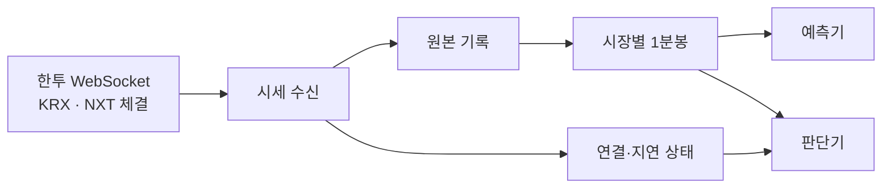

# Market Data 상세 설계 (LLD)

> 상태: 초안 · 2026-10-26
>
> 범위: 관찰 MVP의 시세 수신과 1분봉 생성
>
> 관련 요구사항: [PRD](../prd/PRD.md) R1·R3·R4·R5 / [HLD](../hld/HLD.md) 4.1장

## 1. 이 컴포넌트가 하는 일

한투에서 관심 종목의 체결 시세를 실시간으로 받는다. 체결을 **종목·시장·1분 구간별로 모아 1분봉**을 만들고, 예측기와 판단기에 전달한다. 데이터가 끊기거나 늦게 오면 정상 가격처럼 사용하지 않도록 상태와 이유도 함께 전달한다.

예를 들어 삼성전자 KRX 체결이 10:00:00부터 10:00:59까지 들어왔다면 `KRX / 삼성전자 / 10:00` 봉 하나를 만든다. 같은 시간의 NXT 체결은 **별도 봉**에 모은다. 10:01이 된 뒤 잠시 늦게 도착하는 체결까지 기다렸다가 봉을 확정한다. 연결이 중간에 끊겼다면 가격이 일부 있어도 그 봉은 불완전하다고 표시한다.

## 2. 어디서 받아 무엇을 내보내나

한투 공식 예제의 KRX 실시간 체결 채널은 `H0STCNT0`, NXT는 `H0NXCNT0`이다. 첫 구현은 두 채널을 별도로 구독한다. 통합 체결 채널 `H0UNCNT0`을 동시에 봉에 합치지 않는다. 동일 체결을 중복 집계할 수 있기 때문이다. 실제 계좌와 접속 환경에서 각 채널의 수신 가능 여부는 연결 시험으로 확인한다. [한투 국내주식 WebSocket 예제](https://github.com/koreainvestment/open-trading-api/blob/main/examples_user/domestic_stock/domestic_stock_functions_ws.py)

| 구분 | 내용 |
| --- | --- |
| 입력 | 관심 종목의 KRX·NXT 실시간 체결, 구독 응답, 연결 상태 |
| 원본 기록 | 받은 시세 데이터와 채널, 수신 시각, 수신 순서 |
| 출력 1 | 종목·시장별 최신 체결과 수신 상태 |
| 출력 2 | 확정된 1분봉과 품질 상태 |

첫 관찰 MVP의 봉은 **실제 체결**로만 만든다. 호가와 예상체결은 가격·거래량에 넣지 않는다. 호가 채널(`H0STASP0`, `H0NXASP0`)은 거래비용 판단에 필요해질 때 별도 최신 상태로 연결한다.

관심 종목을 바꾸면 기존 구독과 새 목록의 차이만 등록·해제한다. 구독 응답을 확인하기 전에는 그 종목을 정상 수신 상태로 표시하지 않는다. `dev`와 `prd`는 접속키, 구독 상태, 기록 경로를 분리한다.

## 3. 체결 한 건을 처리하는 순서

1. **수신:** WebSocket에서 데이터를 읽고 수신 시각을 붙인다. 한 메시지에 체결이 여러 건이면 각각의 위치를 구분한다.
2. **기록:** 데이터 메시지를 환경별 원본 파일에 먼저 기록한다. 인증키와 승인 응답의 비밀값은 기록하지 않는다.
3. **검증:** 종목, 시장, 체결 시각, 가격, 체결 수량을 읽는다. 필수 값이 없거나 잘못되면 봉에 넣지 않고 오류와 원본 위치를 남긴다.
4. **집계:** 유효한 체결을 해당 시장의 1분 구간에 추가한다. 가격의 첫 값·최고·최저·마지막 값으로 시가·고가·저가·종가를 만들고 체결 수량을 합친다.
5. **확정:** 분 경계와 허용 지각 시간이 지나면 봉과 상태를 기록한 뒤 발행한다. 예측기와 판단기는 이 확정 이벤트를 받는다.

**봉의 기준 시각은 한투가 제공한 체결 시각**이다. 시스템이 받은 시각은 지연 여부를 판단하는 데 쓴다. 저장은 UTC로 하되 거래일과 1분 경계는 `Asia/Seoul` 기준으로 계산한다. 제공처 날짜나 장 구간을 해석할 수 없는 체결은 현재 날짜·시장으로 추측해 집계하지 않는다.

WebSocket 읽기, 파일 기록, 봉 집계는 별도 작업으로 돌린다. 작업 사이 대기열에는 상한을 둔다. 기록이 밀려 체결을 보존하지 못하면 조용히 건너뛰지 않고 해당 시간대를 **누락 구간**으로 표시한다. AI 분석과 AWS 게시 작업은 이 대기열을 공유하지 않는다.

## 4. 1분봉은 언제 쓸 수 있나

각 봉의 키는 `(환경, 종목, 시장, 장 구간, 분 시작 시각)`이다. KRX와 NXT, 서로 다른 장 구간의 거래량을 섞지 않는다. 봉은 분 경계 이후 설정된 `late_grace`만큼 기다린 뒤 한 번 확정한다. 실제 `late_grace` 값은 장중 지연을 측정해 관찰 MVP 시작 전에 정한다.

| 봉 상태 | 발생 조건 | 예측·신규 진입 판단 |
| --- | --- | --- |
| `READY` | 유효한 체결이 있고 관측된 누락이 없음 | 수신·확정 지연도 허용 범위이면 사용 |
| `INCOMPLETE` | 연결 단절, 구독 오류, 대기열 초과, 파서 오류 등이 해당 분에 영향 | 사용하지 않음 |
| `EMPTY_UNVERIFIED` | 해당 분에 받은 체결이 없음 | 사용하지 않음. 이전 가격으로 채우지 않음 |

`READY`는 수집기가 관측한 범위에서 정상이라는 뜻이다. 연결이 살아 있어도 공급자가 체결을 빠짐없이 보냈는지는 알 수 없으므로, 장후 조회 데이터와 표본 대조한다. 실제 무거래가 확인되면 원본 봉을 수정하지 않고 `NO_TRADE` 대조 결과를 따로 남긴다.

확정 후 도착한 체결도 원본에는 남긴다. 이미 발행한 봉이나 그 봉을 사용한 판단은 바꾸지 않는다. 사후 분석·학습에는 별도 보정 버전을 명시해서 쓸 수 있다.

봉이 확정되면 `bar_id`, 품질 상태, 확정 시각을 예측기와 판단기에 알린다. 상태가 `READY`가 아니거나 최신성 한도를 넘었다면 판단기는 그 이유를 기록하고 **신규 진입을 대기**한다. 이전의 정상 봉을 현재 봉처럼 재사용하지 않는다.

## 5. 끊기거나 다시 시작하면

| 상황 | 처리 |
| --- | --- |
| 연결 단절·구독 실패 | 영향받은 시장·종목을 지연 상태로 표시하고 재접속·재구독한다. 단절이 겹친 봉은 `INCOMPLETE`로 남긴다. |
| 체결이 한동안 오지 않음 | 무거래인지 수신 문제인지 단정하지 않는다. 마지막 체결 시각과 구독 상태를 보여주고, 필요한 경우 공급자 조회로 확인한다. |
| 수신 대기열 초과·기록 실패 | 영향 구간과 이유를 기록한다. 원본에 없는 체결을 봉이나 판단 입력에 넣지 않는다. |
| 프로세스 재시작 | 마지막으로 디스크에 기록된 원본부터 재생한다. 꺼져 있던 구간은 누락으로 표시하고 새 구독 상태를 확인한다. |
| 사후 조회로 누락 보충 | 조회 시각과 `REST_BACKFILL` 출처를 붙인다. 실시간으로 받은 봉처럼 표시하거나 과거 판단을 수정하지 않는다. |

원본과 확정 봉은 `dev`·`prd` 및 거래일별 JSONL 파일에 추가한다. 처리 위치를 체크포인트로 남겨 재시작 시 원본을 중복 집계하지 않는다. 체크포인트는 대응하는 기록이 디스크에 반영된 다음에만 전진한다. 장후 분석용 Parquet은 이 기록에서 별도로 만든다. 비밀키는 어느 파일에도 저장하지 않는다.

## 6. 구현 계약

첫 구현에서 다음 세 이벤트를 버전과 함께 정의한다. 필드 이름은 예시이며, 한투 실제 메시지를 받아 확인한 뒤 고정한다.

| 이벤트 | 반드시 담을 정보 |
| --- | --- |
| `MarketTick.v1` | 내부 ID, 환경, 종목, 시장, 장 구간, 체결 시각, 수신 시각, 가격, 체결 수량, 원본 위치 |
| `MinuteBar.v1` | 봉 ID, 종목, 시장, 장 구간, 시작·종료 시각, OHLC, 거래량, 체결 수, 품질 상태, 확정 시각, 원인 틱 범위 |
| `MarketHealth.v1` | 종목, 시장, 구독 상태, 마지막 수신 시각, 누락 시작 시각, 지연·오류 이유 |

내부 체결 ID는 연결 세대·수신 순서·메시지 내 위치로 만든다. 공급자가 체결 고유 ID를 준다고 가정하지 않는다. 원본을 다시 읽을 때는 내부 ID로 중복 적용을 막는다. 실시간으로 재전송된 것처럼 보이는 체결은 단순히 내용이 같다는 이유로 버리지 않고, 누적 거래량 및 사후 조회로 대조한다.

거래일·휴장·장 구간은 별도의 시장 달력과 확인된 제공처 코드를 따른다. 의미를 알 수 없는 코드나 장 구간은 `UNKNOWN`으로 남기고 거래 가능 상태로 표시하지 않는다. 장 시간을 코드에 고정하지 않는다.

## 7. 완료 기준과 남은 확인

구현 후 다음 사례를 재생 데이터와 실제 수신 데이터로 확인한다.

- KRX·NXT 체결이 교차 도착해도 시장별 봉이 분리된다.
- 늦은 체결은 확정 전에는 해당 분에 들어가고, 확정 후에는 과거 봉을 바꾸지 않는다.
- 연결이 끊긴 분은 체결이 일부 있어도 `INCOMPLETE`다.
- 체결이 없는 분은 가격이 `null`인 `EMPTY_UNVERIFIED`이며 이전 가격을 복사하지 않는다.
- 같은 원본 파일을 재생해도 체결 수량과 봉이 중복되지 않는다.
- 각 화면과 판단 기록에서 시장, 마지막 수신 시각, 봉 상태, 보류 이유를 확인할 수 있다.

구현 전에는 **한투 계좌의 KRX·NXT 구독 가능 범위**, 실제 수신 필드와 장 구간 코드, 연결이 끊긴 동안 조회 API로 복구할 수 있는 범위를 확인한다. 장중 표본으로 `late_grace`, 시세 최신성 한도, 대기열 크기와 재접속 간격을 정한다. 확인되지 않은 시장·장 구간은 자동매매 입력으로 활성화하지 않는다.
