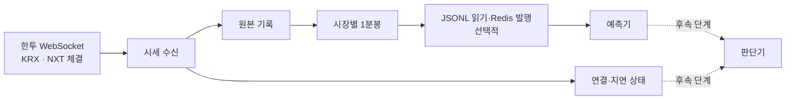
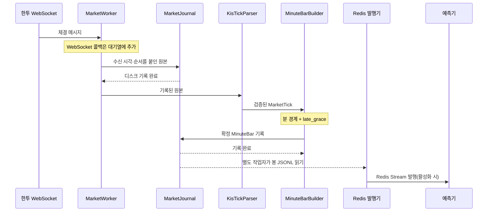
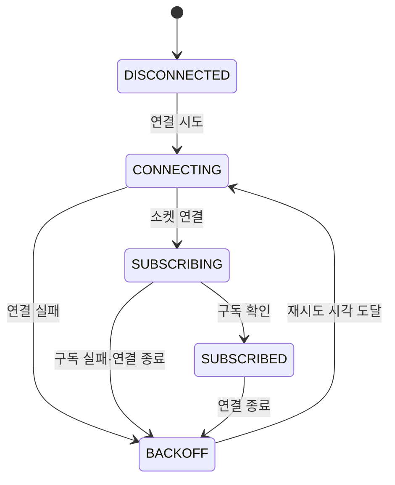

# Market Data 상세 설계 (LLD)

> 상태: 구현 현황 반영 · 2026-10-26
>
> 범위: 관찰 MVP의 시세 수신과 1분봉 생성
>
> 관련 요구사항: [PRD](../prd/PRD.md) R1·R3·R4·R5 / [HLD](../hld/HLD.md) 4.1장

이 문서는 현재 구현과 목표 설계를 함께 기록한다. **현재** `market-data`는 한투 WebSocket 체결을 받아 로컬 JSONL에 기록하고 KRX·NXT별 1분봉을 만든다. Redis Stream 발행은 설정을 켰을 때 별도 작업자가 수행한다. 주문·매매 판단 연결, 장후 Parquet 변환, DynamoDB 게시, 거래일별 자동 기동은 후속 단계다.

## 1. 이 컴포넌트가 하는 일

한투에서 관심 종목의 체결 시세를 실시간으로 받는다. 체결을 **종목·시장·1분 구간별로 모아 1분봉**을 만들고, 선택적으로 Redis를 통해 예측기에 전달한다. 데이터가 끊기거나 늦게 오면 정상 가격처럼 사용하지 않도록 상태와 이유도 함께 기록한다. 판단기 연동은 후속 단계다.

예를 들어 삼성전자 KRX 체결이 10:00:00부터 10:00:59까지 들어왔다면 `KRX / 삼성전자 / 10:00` 봉 하나를 만든다. 같은 시간의 NXT 체결은 **별도 봉**에 모은다. 10:01이 된 뒤 잠시 늦게 도착하는 체결까지 기다렸다가 봉을 확정한다. 연결이 중간에 끊겼다면 가격이 일부 있어도 그 봉은 불완전하다고 표시한다.

## 2. 어디서 받아 무엇을 내보내나

한투 공식 예제의 KRX 실시간 체결 채널은 `H0STCNT0`, NXT는 `H0NXCNT0`이다. 첫 구현은 두 채널을 별도로 구독한다. 통합 체결 채널 `H0UNCNT0`을 동시에 봉에 합치지 않는다. 동일 체결을 중복 집계할 수 있기 때문이다. 실제 계좌와 접속 환경에서 각 채널의 수신 가능 여부는 연결 시험으로 확인한다. [한투 국내주식 WebSocket 예제](https://github.com/koreainvestment/open-trading-api/blob/main/examples_user/domestic_stock/domestic_stock_functions_ws.py)

| 구분 | 내용 |
| --- | --- |
| 입력 | 관심 종목의 KRX·NXT 실시간 체결, 구독 응답, 연결 상태 |
| 원본 기록 | 받은 시세 메시지와 채널, 수신 시각, 연결별 수신 순서 |
| 출력 1 | 종목·시장별 최신 체결과 수신 상태 |
| 출력 2 | 확정된 1분봉과 품질 상태 |

첫 관찰 MVP의 봉은 **실제 체결**로만 만든다. 호가와 예상체결은 가격·거래량에 넣지 않는다. 호가 채널(`H0STASP0`, `H0NXASP0`)은 거래비용 판단에 필요해질 때 별도 최신 상태로 연결한다.

관심 종목은 기본 설정과 컨트롤타워가 기록한 `control/watchlist.json`을 합쳐 결정한다. **현재 구현은 목록 변경을 약 2초 간격으로 확인하고 소켓 전체를 다시 연결해 모든 관심 종목을 재구독한다.** 변경으로 끊긴 시간은 누락 구간이 될 수 있다. 새 종목의 봉은 추가 시점 이후 첫 온전한 분부터 만든다. 구독 응답을 확인하기 전에는 그 종목을 정상 수신 상태로 표시하지 않는다. `dev`와 `prd`는 접속키, 구독 상태, 기록 경로를 분리한다.

## 3. 체결 한 건을 처리하는 순서

1. **수신:** WebSocket에서 데이터를 읽고 수신 시각을 붙인다. 한 메시지에 체결이 여러 건이면 각각의 위치를 구분한다.
2. **기록:** 데이터 메시지를 환경별 원본 파일에 먼저 기록한다. 인증키와 승인 응답의 비밀값은 기록하지 않는다.
3. **검증:** 종목, 시장, 체결 시각, 가격, 체결 수량을 읽는다. 필수 값이 없거나 잘못되면 봉에 넣지 않고 원본 메시지와 `INVALID_FRAME` 누락 구간을 남긴다.
4. **집계:** 유효한 체결을 해당 시장의 1분 구간에 추가한다. 가격의 첫 값·최고·최저·마지막 값으로 시가·고가·저가·종가를 만들고 체결 수량을 합친다. 확정 시 체결 가격의 거래량 가중 25%·50%·75% 분위값도 계산한다.
5. **확정:** 분 경계와 허용 지각 시간이 지나면 봉과 상태를 JSONL에 기록한다. Redis를 활성화한 경우 별도 작업자가 이 파일을 읽어 Stream에 발행하고 예측기가 소비한다. 판단기 연결은 아직 구현되지 않았다.

**봉의 기준 시각은 한투가 제공한 체결 시각**이다. 시스템이 받은 시각은 지연 여부를 판단하는 데 쓴다. 저장은 UTC로 하되 거래일과 1분 경계는 `Asia/Seoul` 기준으로 계산한다. 제공처 날짜나 장 구간을 해석할 수 없는 체결은 현재 날짜·시장으로 추측해 집계하지 않는다.

현재 WebSocket 콜백은 수신 메시지를 상한이 있는 대기열에 넣고 바로 돌아온다. **단일 `MarketWorker`가 대기열에서 꺼내 원본 기록·검증·봉 집계·확정을 순서대로 처리한다.** Redis 발행은 봉 파일을 읽는 별도 작업이다. 대기열이 차면 해당 시간대를 **누락 구간**으로 표시한다. AI 분석과 AWS 게시 작업은 이 대기열을 공유하지 않는다.

### 구성 요소별 책임

아래는 현재 Kotlin 구현의 주요 클래스다. 외부 API 응답 형식이 집계 로직으로 퍼지지 않게 한다.

| 구성 요소 | 맡는 일 | 다음 단계에 전달하는 값 |
| --- | --- | --- |
| `KisWebSocketConnector`·`ManagedMarketSymbols` | 연결, 관심 종목 확인, 변경 시 재접속·재구독 | 구독 결과와 연결 상태 |
| `MarketWorker` | 수신 시각·순서 부여 메시지를 제한된 대기열에서 처리 | 원본 메시지, 상태 변화 |
| `MarketJournal` | 원본·봉·누락 JSONL 추가 기록과 재생 | 기록된 원본·봉·누락 구간 |
| `KisTickParser` | 채널별 필드 해석, 값·시장·시각 검증 | `MarketTick` 또는 오류 사유 |
| `MarketEngine` | 원본 기록 후 파싱·집계·확정, 재시작 시 재생 | 확정된 `MinuteBar` |
| `MinuteBarBuilder` | 종목·시장별 집계, 분 경계에 봉 확정 | `MinuteBar` |
| `MarketHealthTracker` | 메모리의 구독 상태·마지막 체결 수신 시각 관리 | `MarketHealth` 조회값 |
| `MinuteBarStreamPublisher` | 확정 봉 JSONL을 읽어 Redis Stream에 발행(선택적) | `MinuteBar.v1` 메시지 |

`KisTickParser`만 한투의 체결 필드 위치를 알아야 한다. `MinuteBarBuilder`는 정규화된 체결과 누락 구간만 받는다. 원본 기록 성공을 확인하기 전에는 정규화 결과를 집계하지 않는다.

### 체결 처리 시퀀스

원본 기록이나 검증이 실패하면 체결은 봉으로 넘어가지 않는다. 봉 기록이 실패하면 발행하지 않는다. 연결·대기열 장애는 `MarketWorker`가 누락 구간으로 기록하고, `MinuteBarBuilder`가 해당 봉을 `INCOMPLETE`로 확정한다.

## 4. 1분봉은 언제 쓸 수 있나

각 봉의 키는 `(환경, 종목, 시장, 장 구간, 분 시작 시각)`이다. KRX와 NXT, 서로 다른 장 구간의 거래량을 섞지 않는다. 봉은 분 경계 이후 설정된 `late_grace`만큼 기다린 뒤 한 번 확정한다. 현재 기본값은 **3초**이며 실제 지연 분포를 보고 조정한다.

분위값은 가격을 낮은 순서로 정렬하고 각 체결 수량을 가중치로 더해 구한다. 누적 거래량이 전체 거래량의 25%·50%·75%에 처음 도달한 가격을 각각 `priceP25`·`priceP50`·`priceP75`로 기록한다. 따라서 `priceP50`은 거래량 가중 중앙값이다. 선형 보간은 하지 않으며 체결 가격 중 하나가 결과가 된다. `EMPTY_UNVERIFIED` 봉의 분위값은 `null`이다. 일부 체결만 남은 `INCOMPLETE` 봉에도 관측된 체결로 계산한 값은 기록하지만, 예측 입력으로 사용하지 않는다.

| 봉 상태 | 발생 조건 | 예측·신규 진입 판단 |
| --- | --- | --- |
| `READY` | 유효한 체결이 있고 관측된 누락이 없음 | 수신·확정 지연도 허용 범위이면 사용 |
| `INCOMPLETE` | 연결 단절, 구독 오류, 대기열 초과, 파서 오류 등이 해당 분에 영향 | 사용하지 않음 |
| `EMPTY_UNVERIFIED` | 해당 분에 받은 체결이 없음 | 사용하지 않음. 이전 가격으로 채우지 않음 |

`READY`는 수집기가 관측한 범위에서 정상이라는 뜻이다. 연결이 살아 있어도 공급자가 체결을 빠짐없이 보냈는지는 알 수 없으므로, 장후 조회 데이터와 표본 대조해야 한다. 실제 무거래가 확인되면 원본 봉을 수정하지 않고 `NO_TRADE` 대조 결과를 따로 남기는 작업은 후속 단계다.

확정 후 도착한 체결도 원본에는 남긴다. 이미 발행한 봉이나 그 봉을 사용한 판단은 바꾸지 않는다. 사후 분석·학습에는 별도 보정 버전을 명시해서 쓸 수 있다.

Redis 발행을 활성화하면 확정 봉의 `bar_id`, 품질 상태, 확정 시각을 예측기가 받는다. 향후 판단기는 `READY`가 아니거나 최신성 한도를 넘은 봉을 신규 진입에 사용하지 않아야 한다. 이전의 정상 봉을 현재 봉처럼 재사용하지 않는다.

## 5. 끊기거나 다시 시작하면

### WebSocket 구독 상태

`SUBSCRIBED`는 구독이 확인됐다는 뜻이다. **시세가 최신이라는 뜻은 아니다.** `MarketHealthTracker`는 마지막 수신 시각을 조회할 수 있게 보관하고, 누락 구간은 별도 기록한다. 재접속 후에도 장애가 걸친 과거 봉은 정상으로 바꾸지 않는다.

| 상황 | 처리 |
| --- | --- |
| 연결 단절·구독 실패 | 영향받은 시장·종목을 지연 상태로 표시하고 재접속·재구독한다. 단절이 겹친 봉은 `INCOMPLETE`로 남긴다. |
| 체결이 한동안 오지 않음 | 무거래인지 수신 문제인지 단정하지 않는다. 마지막 체결 시각과 구독 상태를 보여주고, 필요한 경우 공급자 조회로 확인한다. |
| 수신 대기열 초과·기록 실패 | 영향 구간과 이유를 기록한다. 원본에 없는 체결을 봉이나 판단 입력에 넣지 않는다. |
| 프로세스 재시작 | 현재는 전날·당일의 확정 봉과 누락 구간을 읽고, 해당 날짜의 원본을 다시 재생한다. 이미 확정된 봉 ID는 다시 기록하지 않으며, 중단 구간을 누락으로 표시한다. 영속 체크포인트는 아직 없다. |
| 사후 조회로 누락 보충(후속) | 조회 시각과 `REST_BACKFILL` 출처를 붙인다. 실시간으로 받은 봉처럼 표시하거나 과거 판단을 수정하지 않는다. |

### 데이터는 어디에 저장하나

이 시세 경로는 **RDB 테이블에 체결과 1분봉을 적재하지 않는다.** 장중 처리에는 메모리를 쓰고, 다시 읽어야 하는 사실 기록은 Mac의 파일에 남긴다.

| 저장 위치 | 저장하는 데이터 | 쓰는 이유 |
| --- | --- | --- |
| Mac 메모리 | 최신 체결, 집계 중인 1분봉, 구독·지연 상태 | 장중 빠른 처리. 재시작 후 원본에서 복원 |
| Mac JSONL 파일 | 받은 시세 원본, 확정 1분봉, 누락·오류 기록 | 판단 당시의 데이터 보존과 재생 |
| Mac Parquet 파일(후속) | 장후 JSONL에서 정리한 1분봉·분석용 데이터 | 학습, 검증, 장기 조회 |
| AWS DynamoDB(후속) | 원격 모니터링에 필요한 최신 상태 요약만 | 안드로이드 앱 조회. 시세 원본 저장소가 아님 |

JSONL은 `dev`·`prd`, 거래일, 데이터 종류별로 파일을 분리한다. 현재는 전날·당일 파일을 재생하고 확정된 봉 ID로 중복 기록을 막는다. Redis 발행 작업자는 별도의 파일 읽기 위치를 기록한다. Parquet 생성과 AWS 게시를 추가할 때에도 로컬 시세 처리와 분리한다. 비밀키는 어느 파일에도 저장하지 않는다.

## 6. 구현 계약

아래 이름은 **처리 단계 사이에 전달하고 파일에 기록할 데이터 형식**이다. RDB 테이블 이름이 아니다. Kotlin 데이터 클래스에 구현한 필드를 요약했다.

| 이벤트 | 반드시 담을 정보 |
| --- | --- |
| `MarketTick.v1` | 내부 ID, 환경, 종목, 시장, 장 구간, 체결 시각, 수신 시각, 가격, 체결 수량, 원본 메시지 ID |
| `MinuteBar.v1` | 봉 ID, 종목, 시장, 장 구간, 시작·종료 시각, OHLC, 거래량, 체결 수, 거래량 가중 가격 분위값(`priceP25`·`priceP50`·`priceP75`), 품질 상태, 확정 시각, 원인 틱 범위 |
| `MarketHealth.v1` | 종목, 시장, 구독 상태, 마지막 수신 시각, 누락 시작 시각, 오류 이유. 현재 메모리 조회값이며 별도 파일 이벤트로 기록하지 않음 |

내부 체결 ID는 연결 세대·수신 순서·메시지 내 위치로 만든다. 공급자가 체결 고유 ID를 준다고 가정하지 않는다. 원본을 다시 읽을 때는 내부 ID로 중복 적용을 막는다. 실시간으로 재전송된 것처럼 보이는 체결은 단순히 내용이 같다는 이유로 버리지 않고, 누적 거래량 및 사후 조회로 대조한다.

기존 봉 JSONL에는 분위값 필드가 없을 수 있다. 이를 읽을 때 세 값은 `null`로 취급하고 확정된 과거 봉을 소급 수정하지 않는다. 과거 OHLCV 조회 데이터만으로는 체결 가격 분포를 복원할 수 없다. 학습 데이터에 과거 분위값이 필요하면 체결 원본으로 별도 파생 데이터셋을 만든다.

현재 장 구간은 실행 설정의 날짜·시장·시작·종료 시각으로 지정한다. 매칭되지 않는 체결은 파싱 오류로 기록하고 봉에 넣지 않는다. 거래일·휴장·장 구간을 검증하는 시장 달력은 후속 구현이다.

### 자동 기동과 종료

2026-10-27~30 모의투자 시험에서는 Mac의 `launchd`가 감독 프로세스를 유지한다. 감독 프로세스는 네 날짜의 07:30~20:30 KST에 `market-data`, `event-data`, `price-prediction`을 실행하고, 종료한 프로세스를 재시작한다. 재부팅 뒤 로그인하거나 장중에 시작해도 현재 시각을 평가한다. 이 시험의 날짜와 장 구간은 코드에 고정돼 있다.

1. 장 시작 전에 해당 날짜의 시장·장 구간·관심 종목 설정을 검증한다. 휴장 또는 달력 미확정 시에는 수집기를 시작하지 않고 이유를 상태 파일과 경보에 남긴다.
2. 첫 유효 장 구간이 시작되기 전에 WebSocket을 연결하고 KRX·NXT 구독 확인을 기다린다. 시장별 장 구간은 달력에서 가져오며, 하나의 시장이 쉬는 동안에도 다른 시장의 수신은 유지한다.
3. 연결 중단 시 수집기 내부 재접속을 사용하고, 프로세스가 종료되면 감독 프로세스가 재기동한다. 장중 늦게 시작했다면 시작 전 구간을 결손으로 기록한다. 이전 분을 정상 수신한 것처럼 만들지 않는다.
4. 마지막 장 구간과 봉 확정 유예가 끝나면 수집기를 정상 종료한다. 시장의 임시 중단·연장 공지가 있으면 확인된 달력·운영 설정을 갱신한 뒤 종료 시각을 다시 계산한다.
5. 다음 거래일에는 새 날짜의 설정을 만들어 반복한다. 감독 프로세스는 PID뿐 아니라 구독 확인, 마지막 유효 수신 시각, 봉 생성 지연과 재시작 횟수를 감시한다. 장외에는 시세 미수신을 장애로 간주하지 않는다.

범용 운영 전에는 시험용 고정 날짜를 버전이 있는 거래일 달력으로 교체하고, 휴장·임시 중단·연장 및 종목별 거래 가능 여부를 반영해야 한다. 이 시험은 지정한 네 날짜에만 자동 실행하며, 과거 데이터 조회는 별도의 [배치 작업](04-learning-data-and-feedback.md)이다. [로컬 실행 안내](../../monitoring/README.md#10271030-모의투자-수집-시험)

## 7. 완료 기준과 남은 확인

다음 사례를 재생 데이터와 실제 수신 데이터로 확인한다. 현재 자동화 테스트는 시장별 봉 분리, 무체결 분, 누락 구간, 지각 체결, 원본 재생, 잘린 JSONL 행을 검증한다.

- KRX·NXT 체결이 교차 도착해도 시장별 봉이 분리된다.
- 늦은 체결은 확정 전에는 해당 분에 들어가고, 확정 후에는 과거 봉을 바꾸지 않는다.
- 연결이 끊긴 분은 체결이 일부 있어도 `INCOMPLETE`다.
- 체결이 없는 분은 가격이 `null`인 `EMPTY_UNVERIFIED`이며 이전 가격을 복사하지 않는다.
- 같은 원본 파일을 재생해도 체결 수량과 봉이 중복되지 않는다.
- 구독 실패와 연결 종료 후 재시도해도 관심 종목 구독이 복구되고, 중단 구간은 정상 봉으로 바뀌지 않는다.
- 각 화면과 판단 기록에서 시장, 마지막 수신 시각, 봉 상태, 보류 이유를 확인할 수 있다.

2026-10-26 한투 모의투자 WebSocket에서 삼성전자 `005930`의 KRX·NXT 수신을 확인했다. 다만 이 결과만으로 다른 종목·실전 계좌의 구독 가능 범위나 누락 없는 수신을 보장하지 않는다. 후속으로 장후 기준 데이터와 대조하고, 연결 중단 시 조회 API로 복구할 수 있는 범위 및 지연 분포를 측정해야 한다. 그 결과로 `late_grace`, 시세 최신성 한도, 대기열 크기와 재접속 간격을 조정한다. 확인되지 않은 시장·장 구간은 자동매매 입력으로 활성화하지 않는다.
