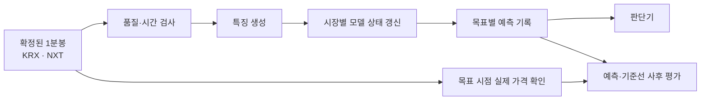
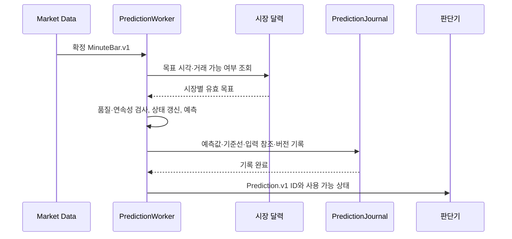

# Price Prediction 상세 설계 (LLD)

> 상태: 초안 · 2026-10-26
>
> 범위: 관찰 MVP의 가격 예측과 사후 평가. 주문 실행은 포함하지 않는다.
>
> 관련 요구사항: [PRD](../prd/PRD.md) R3·R5·R9 / [HLD](../hld/HLD.md) 5.1장 / [Market Data LLD](01-market-data.md) / [Historical Data & Feedback Loop LLD](04-learning-data-and-feedback.md)

## 1. 이 컴포넌트가 하는 일

확정된 1분봉을 입력받아 종목·시장별 미래 가격을 예측하고, 예측 당시의 입력과 모델 버전을 남긴다. 목표 시점이 지난 뒤에는 실제 가격을 별도로 확인해 오차를 계산한다. 예측값은 **판단기의 입력**이며, 예측기가 직접 주문하지 않는다.



예를 들어 KRX의 10:00 봉이 10:01 이후 확정되었다면, 그 **확정 시점까지 확보한 정보**로 KRX의 다음 1분과 1시간 뒤 가격, 당일 KRX 공식 종가를 예측한다. NXT 봉과 NXT 종료 가격은 별도 시장 상태로 처리한다. KRX와 NXT의 가격·거래량을 하나의 봉으로 섞지 않는다.

## 2. 무엇을 예측하나

단기 목표 두 개는 시장별로 계산한다. 종료 가격 두 개는 해당 시장에서만 계산한다. 따라서 두 시장이 모두 유효하게 열려 있다면 한 종목에서 최대 **여섯 개의 예측 기록**이 나온다. PRD의 네 가지 *목표 유형*을 시장별로 펼친 결과다.

| 목표 유형 | 기준 입력 | 목표 가격과 시각 | 예측을 만들 수 없는 경우 |
| --- | --- | --- | --- |
| `NEXT_1M` | 해당 시장의 확정 1분봉 | 기준 봉의 바로 다음 달력상 분에 해당하는 **1분봉 종가**. 다음 분이 같은 연속 장 구간에 있어야 한다. | 다음 분이 휴장·장 경계에 걸리거나 예측 생성 전에 목표 분이 끝났을 때 |
| `AFTER_1H` | 해당 시장의 확정 1분봉 | 기준 봉 시작 시각에서 **정확히 60분 뒤** 시작하는 1분봉의 종가. 기준 시각과 목표 시각 사이가 같은 연속 장 구간이어야 한다. | 중간에 장이 닫히거나 예측 생성 전에 목표 분이 끝났을 때 |
| `KRX_CLOSE` | KRX 확정 1분봉 | 해당 거래일의 **확인된 KRX 공식 종가**. 목표 시각은 시장 달력의 종가 확정 시각이다. | 공식 종가의 출처·확정 여부를 확인하지 못했거나 이미 목표 시각이 지났을 때 |
| `NXT_END` | NXT 확정 1분봉 | 해당 거래일의 **확인된 NXT 거래 종료 기준 가격**. 목표 시각은 해당 종목의 NXT 거래 종료 시각이다. | 종료 가격의 출처·정의·확정 여부를 확인하지 못했거나 이미 목표 시각이 지났을 때 |

`NEXT_1M`의 “다음”은 다음 **달력상 1분**이다. 체결이 없다는 이유로 여러 분을 건너뛰어 처음 나타난 봉을 다음 1분의 정답으로 삼지 않는다. `AFTER_1H`도 60개 봉을 세는 방식이 아니라 시각으로 정한다. 장 구간과 종목별 거래 가능 여부는 확인된 시장 달력에서 읽으며 코드에 시간을 고정하지 않는다.

단기 목표의 `targetAt`은 **목표 봉의 종료 시각**이다. 예측은 `createdAt < targetAt`일 때만 유효하다. 미래 목표 분에 실제 체결이 없거나 봉 품질이 나쁘면 예측 기록은 그대로 두고, 나중에 `PredictionActual`을 확인 불가로 남겨 평가에서 제외한다. 미래의 정답 유무를 예측 시점의 입력 검사에 사용하지 않는다.

KRX 공식 종가는 장중 마지막 체결이나 15:29 봉의 종가로 대체하지 않는다. NXT 종료 가격도 마지막으로 수신한 프레임만으로 확정하지 않는다. 공식 조회 경로와 NXT 종료 가격 정의는 제공처 자료 및 실제 수신 데이터를 대조해 확정해야 한다. 확인 전에는 종료 가격 목표를 `ACTUAL_DEFINITION_UNCONFIRMED`로 기록한다.

## 3. 1분봉 하나를 처리하는 순서

1. **입력 확인:** `MinuteBar.v1`의 ID, 종목, 시장, 장 구간, 분 시각, `sealedAt`, 품질 상태를 확인한다. `READY`이고 종가가 있으며 최신성 한도 안에 있는 봉만 온라인 상태에 적용한다.
2. **연속성 확인:** 해당 종목·시장·장 구간의 직전 적용 봉과 1분 간격인지 확인한다. 누락·역순·중복 봉은 임의로 이어 붙이지 않는다.
3. **특징 생성:** 가격 자체 대신 직전 가격 대비 로그 수익률, 거래량 변화, 시간대, 목표까지 남은 시간 등으로 구성한다. 모든 특징의 원본은 해당 예측의 기준 시점 전에 확정되어 있어야 한다.
4. **상태 갱신:** `새 1분 데이터 + 이전 상태 → 새 상태`를 한 번 실행한다. 모델 상태는 **환경·종목·시장·장 구간·모델 버전**별로 분리한다.
5. **예측 생성:** 각 목표의 달력상 유효성, 필요한 입력의 완전성, 모델 준비 상태를 검사한다. 가능한 목표만 예측하고, 불가능한 목표는 이유를 남긴다.
6. **기록 후 발행:** 예측과 기준선 값을 파일에 먼저 기록한다. 기록이 성공한 예측의 ID만 판단기에 전달한다.



WebSocket 수신 작업은 모델 계산이나 평가를 기다리지 않는다. 예측 작업에는 상한이 있는 별도 대기열을 둔다. 밀린 봉을 조용히 건너뛰지 않고 처리 지연을 기록하며, 최신성 한도를 넘긴 결과는 판단기에 `STALE`로 전달한다.

### 구성 요소별 책임

| 구성 요소 | 맡는 일 |
| --- | --- |
| `PredictionWorker` | 확정 봉 수신, 순서 보장, 중복 방지, 기록·발행 순서 관리 |
| `InputGate` | 품질·최신성·연속성 검사와 사용 불가 이유 결정 |
| `TargetResolver` | 시장 달력으로 네 목표 유형의 목표 시각과 시장별 적용 여부 결정 |
| `FeatureBuilder` | 시점 누출 없이 특징 생성, 특징 정의 버전 관리 |
| `Forecaster` | 기준선 또는 경량 모델의 상태 갱신과 목표별 가격 출력 |
| `PredictionJournal` | 예측·상태 체크포인트·평가 결과를 환경별 파일에 기록 |
| `ActualResolver` | 목표 시점 후 정답 가격의 출처와 품질 확인 |
| `PredictionEvaluator` | 예측·정답 연결, 기준선과 동일 표본에서 성능 계산 |

## 4. 상태를 가진 경량 모델

첫 구현에서는 **직전 유효 종가를 그대로 예측하는 기준선**을 반드시 제공한다. 이것으로 입력·목표 시각·정답 연결·평가 경로를 먼저 검증한다. 학습 모델은 충분한 거래일의 데이터가 쌓인 뒤 작은 GRU 계열을 후보로 실험한다. 모델 구조와 크기는 Mac에서 측정한 메모리와 분당 추론 시간으로 확정한다. 하루치 데이터만으로 학습 성능을 주장하지 않는다.

모델의 온라인 인터페이스는 아래처럼 정의한다.

```text
step(feature_t, state_t-1) -> state_t, {
  NEXT_1M: 예상 수익률,
  AFTER_1H: 예상 수익률,
  SESSION_END: 예상 수익률
}
예상 가격 = 기준 봉 종가 × exp(예상 수익률)
```

`SESSION_END`는 KRX 상태에서 `KRX_CLOSE`, NXT 상태에서 `NXT_END`에 대응한다. 모델 가중치는 공유할 수 있지만 **실행 중인 상태는 시장별로 독립**이다. 각 출력에는 목표까지 남은 거래 시간 등의 특징이 들어간다. 데이터가 충분해지기 전에는 동일한 인터페이스에서 기준선만 실행한다. 기준선 결과도 모델 결과와 같은 계약으로 저장한다.

기준선은 이전 모델 상태가 필요 없으므로 첫 유효 봉부터 사용할 수 있다. 상태 기반 모델은 정해진 수의 연속 정상 봉을 받은 뒤에만 `READY`가 된다.

`INCOMPLETE`·`EMPTY_UNVERIFIED` 봉이나 누락 구간을 만나면 해당 상태를 끊는다. 다음 `READY` 봉 하나만으로 정상 예측을 재개하지 않는다. 설정된 연속 정상 봉 수로 상태를 다시 준비한 뒤 재개하며, 필요한 수는 재생 데이터와 실제 지연 분포를 보고 정한다. 장 구간 또는 거래일이 바뀌면 상태를 초기화한다. 한 시장의 결손이 다른 시장의 상태를 오염시키지 않는다.

재시작 시에는 동일 모델·특징 버전의 마지막 **내구성 있는 체크포인트**와 이후 확정 봉을 순서대로 재생한다. 체크포인트가 없거나 버전이 다르면 현재 장 구간의 봉을 처음부터 재생해 상태를 복원한다. 재생 중 계산한 과거 예측을 새로운 실시간 판단으로 발행하지 않는다. 예측 ID는 `(환경, 종목, 시장, 기준 봉 ID, 목표 유형, 모델 버전)`으로 결정해 같은 봉 재처리 시 중복 기록을 막는다.

## 5. 예측 결과와 저장 위치

| 저장 위치 | 내용 | 용도 |
| --- | --- | --- |
| Mac 메모리 | 현재 모델 상태와 최신 유효 예측 | 장중 다음 봉 처리와 판단 입력 |
| `data/<환경>/prediction/predictions/<거래일>.jsonl` | 예측값, 기준선, 입력·모델·목표 참조, 사용 불가 이유 | 당시의 예측을 바꾸지 않는 원본 기록 |
| `data/<환경>/prediction/actuals/<거래일>.jsonl` | 사후 확인한 목표 가격·출처·확정 시각 | 예측값과 독립된 정답 기록 |
| `data/<환경>/prediction/checkpoints/` | 모델 상태, 마지막 적용 봉 ID, 모델·특징 버전 | 동일 장 구간 재시작 복원 |
| 장후 Parquet | 특징·예측·정답·오차의 분석용 사본 | 학습과 시간순 평가 |

예측 원본을 정답이 나온 뒤 수정하지 않는다. 정답 정정은 새 버전의 평가 기록으로 연결한다. DynamoDB에는 추후 원격 조회에 필요한 최신 예측 요약만 게시할 수 있으며, 학습 원본으로 쓰지 않는다. 시세 원본과 마찬가지로 `dev`·`prd` 경로와 모델 승격 이력을 분리한다.

### 파일·이벤트 계약

| 이벤트 | 반드시 담을 정보 |
| --- | --- |
| `Prediction.v1` | 예측 ID, 환경, 종목, 시장, 장 구간, 기준 봉 ID·종가·`sealedAt`, 예측 생성 시각, 목표 유형·시각, 예상 가격·기준선 가격, 사용 가능 상태·이유, 모델·특징·달력 버전 |
| `PredictionActual.v1` | 예측 ID, 목표 유형·시각, 실제 가격 또는 확인 불가 이유, 제공처·조회 시각, 확정 상태 |
| `PredictionEvaluation.v1` | 예측 ID, 정답 버전, 모델 절대오차·기준선 절대오차, 평가 시각 |
| `PredictionCheckpoint.v1` | 환경·종목·시장·장 구간, 마지막 적용 봉 ID, 모델·특징 버전, 상태 데이터·기록 시각 |

사용 가능 상태는 `READY`, `WARMING_UP`, `INPUT_INCOMPLETE`, `STALE`, `TARGET_CLOSED`, `ACTUAL_DEFINITION_UNCONFIRMED`, `MODEL_ERROR`로 시작한다. `READY` 이외의 예측은 가격을 `null`로 저장하고 판단기의 신규 진입 근거로 쓰지 않는다. 기준선만 준비된 단계에서는 `modelVersion=baseline-persistence-v1`로 명시한다.

## 6. 학습과 평가

과거 데이터 수집, 원본·데이터셋 버전 관리, 전략 순손익까지 이어지는 피드백 루프는 [Historical Data & Feedback Loop LLD](04-learning-data-and-feedback.md)에 정의한다. 이 컴포넌트는 그 데이터셋에서 예측 모델을 학습하고 동일한 시점·표본의 기준선과 비교한다.

학습은 장중 수집·판단과 분리해, 저장한 확정 봉과 사후 확인된 정답으로 실행한다. 1분마다 전체 과거를 다시 넣어 학습하지 않는다. 학습 시에는 연속된 정상 봉 구간을 시간순으로 펼쳐 상태를 갱신하고, 짧은 구간으로 나눠 역전파한다. 결손·장 경계에서는 상태를 초기화한다. 예측 당시 사용할 수 없던 정정 가격이나 이후 공시는 특징에 포함하지 않는다.

평가 데이터는 **거래일 순서로 학습 → 검증 → 시험**으로 나누고, 경계에 걸친 1시간·종가 정답이 앞 구간의 특징에 새어 들어가지 않게 한다. 초매개변수는 검증 구간에서만 고른다. 최종 시험 구간은 모델 선택 후 한 번 평가한다. 실운영 중에는 새 가중치를 자동 적용하지 않고, 버전을 고정해 `dev`에서 재생·관찰한 다음 승격한다.

| 지표 | 계산·해석 |
| --- | --- |
| 목표별·시장별 MAE | 예측 가격과 실제 가격의 평균 절대오차. 같은 표본의 기준선 MAE와 비교 |
| 방향 적중률 | 기준 봉 종가 대비 상승·하락 방향이 맞은 비율. 0 변화는 별도 집계 |
| 유효 예측 비율 | 생성 대상 중 `READY`이고 이후 정답까지 확인된 비율 |
| 지연·결손 비율 | 봉 확정부터 예측 기록까지 걸린 시간, 목표·입력 불가 사유의 건수 |

모델과 기준선은 **같은 예측 시점·같은 확인된 정답**에서 비교한다. 목표별·시장별·시간대별 표본 수를 함께 보고, 표본이 적거나 기준선보다 낫지 않은 모델은 판단 입력으로 승격하지 않는다. 가격 오차가 낮다는 사실만으로 거래비용을 뺀 수익을 입증한 것으로 보지 않는다.

## 7. 실패와 복구

| 상황 | 처리 |
| --- | --- |
| 봉 누락·연결 장애 | 해당 시장의 모델 상태를 끊고 `INPUT_INCOMPLETE`를 기록한다. 이전 예측값을 최신값처럼 재사용하지 않는다. |
| 모델 계산 실패·시간 초과 | 해당 목표를 `MODEL_ERROR`로 기록하고 수집 작업은 계속한다. 기준선으로 자동 대체한다면 별도 모델 버전으로 표시한다. |
| 재시작·중복 봉 | 체크포인트와 확정 봉을 재생해 상태를 복원한다. 같은 예측 ID는 한 번만 발행한다. |
| 목표 가격 확인 실패 | `PredictionActual`에 확인 불가 이유를 남기고 오차 계산에서 제외한다. 임의의 마지막 수신 가격으로 채우지 않는다. |
| 새 모델 배포 | 기존 예측의 모델 버전을 유지한다. 새 버전은 상태를 새로 준비한 후 사용하며 기존 상태를 해석 없이 넘기지 않는다. |

판단기는 예측의 가격만 받지 않고 **사용 가능 상태, 기준 시각, 목표 시각, 모델 버전**을 함께 받는다. 필요한 목표가 `READY`가 아니면 PRD R5에 따라 신규 진입을 보류하고 이유를 기록한다.

## 8. 구현 순서와 완료 기준

1. 시장 달력과 목표 시각 판정, `Prediction.v1`·정답 연결 규칙을 재생 데이터로 검증한다.
2. 직전 종가 기준선을 구현해 예측·저장·사후 평가의 전체 경로를 완성한다.
3. 여러 거래일의 정상 봉과 결손 구간을 모아 작은 상태 기반 모델을 학습·시간순 평가한다.
4. 기준선보다 나은 모델만 `dev` 관찰 환경에 올리고, 추론 지연·복구·판단 입력을 검증한다.

완료 조건은 두 시장의 단기 목표가 섞이지 않고, KRX·NXT 종료 목표가 각각 확인된 정의로만 평가되며, 누락·재시작 뒤 과거 예측이나 잘못된 정답이 새 판단에 들어가지 않는 것이다. 예측·실제·기준선 비교를 모델 버전과 함께 조회할 수 있어야 한다.

**구현 전 확정할 값:** 장 구간별 시장 달력, KRX 공식 종가와 NXT 종료 가격의 조회·확정 경로, 봉·예측 최신성 한도, 상태 재준비에 필요한 연속 정상 봉 수, 모델 크기와 추론 시간 한도. 오늘의 수집 데이터는 이 값을 정하는 관찰 자료이며 학습·성능 결론을 내리기에는 부족하다.
