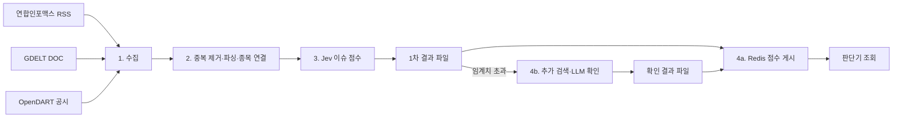

# Event Data 상세 설계 (LLD)

> 상태: 목표 설계 · 2026-10-27. OpenDART·GDELT 수집과 사건 Redis 조회 캐시는 구현되어 있다. RSS·Jev 점수·추가 검색은 아직 구현되지 않았다.
>
> 범위: OpenDART 공시, 연합인포맥스 RSS, GDELT DOC의 수집부터 이슈 점수와 Redis 조회까지. 주문 실행은 포함하지 않는다.
>
> 관련 문서: [PRD](../prd/PRD.md) R2·R4·R5 / [HLD](../hld/HLD.md) 4.2·4.3·5.1장 / [ADR-0002](../adr/0002-event-issue-scoring.md)

## 1. 처리 흐름

사건 수집기와 분석기는 시세 WebSocket 및 매분 가격 예측과 독립적으로 실행한다.

사건과 점수·검색 결과는 파일에 먼저 기록한다. Redis는 복원 가능한 조회 사본이다. 검색이 지연되거나 실패해도 수집과 가격 예측은 계속한다.

## 2. 출처별 수집 계약

| 출처 | 시작 주기 | 입력과 범위 | 중복 키 |
| --- | --- | --- | --- |
| 연합인포맥스 [증권 RSS](https://news.einfomax.co.kr/rss/S1N2.xml)·[IB/기업 RSS](https://news.einfomax.co.kr/rss/S1N7.xml) | 피드별 **5분** | 기사 ID, 제목, 링크, 발행 시각, 짧은 설명 | `nsid` 우선, 없으면 정규화 URL 해시 |
| GDELT DOC `artlist` | 검색어별 **5분** | 최근 1시간을 겹쳐 조회한 제목·URL·출처·제공처 확인 시각 | 정규화 URL 해시 |
| OpenDART `list.json` | 관심 기업별 15분 | 어제·오늘 공시 목록을 끝 페이지까지 조회 | `rcept_no` |
| OpenDART `document.xml` | 새 접수번호 발견 시 | 해당 공시 원본 ZIP | `rcept_no` |

RSS 피드는 최신 항목만 보여준다. 시험에서는 카테고리 피드당 20건을 확인했지만 고정 한도는 아니다. 매 조회에서 직전 응답과 겹치는 기사와 신규 건수를 기록한다. 새 기사 수가 피드 항목 수에 닿거나 겹치는 기사가 없으면 누락 가능성을 표시한다. **5분은 조회 시도 간격**이며 발행부터 피드 반영까지의 지연 보장이 아니다.

GDELT 검색어가 여러 개면 전역 스케줄러가 요청을 순서대로 보내며 전체 요청 간 최소 10초를 유지한다. 5분 안에 모든 검색어를 처리하지 못해도 요청을 동시에 쏟아내지 않는다. 429에서는 `Retry-After`를 우선하고 없으면 대기 시간을 늘린다. GDELT가 반환하는 `seendate`는 원 기사 발행 시각이 아니라 제공처가 확인한 시각으로 기록한다.

OpenDART의 `rcept_dt`는 날짜 필드다. 분·초 단위 공개 시각으로 사용하지 않고 최초 수신 시각을 별도로 남긴다. 정정 공시는 새 접수번호의 독립 사건으로 기록하고 원 공시와 연결한다. 수집기 재시작 뒤에는 겹친 구간을 다시 읽는다.

## 3. 중복 제거·파싱·종목 연결

제공처 어댑터는 RSS XML, GDELT JSON, 공시 응답을 공통 `EventRecord`로 바꾼다. 제공처별 필수 식별자와 제목이 빠진 항목은 사건으로 발행하지 않고 파싱 오류로 기록한다. 뉴스에는 원문 링크도 필요하다. RSS 설명은 기사 전문이 아니다. GDELT의 기사 URL을 따라가 본문을 자동 수집하지 않는다.

| 구분 | 규칙 |
| --- | --- |
| RSS 제공처 ID | `EINFOMAX:<nsid>`; 없으면 정규화 URL의 SHA-256 |
| GDELT 제공처 ID | `GDELT:<정규화 URL의 SHA-256>` |
| 뉴스 사건 ID | `NEWS:<정규화 원문 URL의 SHA-256>`; 두 제공처의 관측을 이 ID에 연결 |
| 공시 사건 ID | `DART:<rcept_no>` |
| 종목 연결 | `(eventId, symbol)`; 하나의 사건은 여러 종목에 연결될 수 있음 |
| URL 정규화 | 확인된 추적 파라미터만 제거하고 기사 식별에 필요한 경로·쿼리는 보존 |

동일 기사가 여러 RSS 피드 또는 GDELT 검색 결과에 나오면 정규화 원문 URL로 하나의 뉴스 사건에 묶고 제공처 ID를 관측 기록으로 추가한다. 제목만으로 합치지 않는다. 종목코드·회사명·별칭·DART 고유번호를 관심 종목 등록부에서 조회한다. 연결이 애매하면 `UNCERTAIN`으로 표시하고 점수·매매 입력을 보류한다. 새 관심 종목이 기존 사건에 연결되면 그 종목의 Jev 작업을 별도로 생성한다.

## 4. Jev 1차 이슈 점수

종목 연결이 확인된 새 사건을 비동기 Jev 작업자가 분석한다. RSS는 제목·짧은 설명·시점 정보, GDELT는 제공된 제목·메타데이터, 공시는 확보한 원본에서 분석 가능한 범위를 입력으로 사용한다. 제목만으로 근거가 부족한 경우에는 점수의 신뢰도를 낮추거나 `NOT_AVAILABLE`로 둔다. 결과에는 **관련성, 방향, 영향 강도, 신뢰도, 근거, 완료 시각**을 기록한다. 점수 범위와 추가 검색 임계치는 dev 표본으로 보정하고 버전 있는 정책으로 확정한다.

`analysisId = (environment, eventId, symbol, analysisVersion)`이다. `analysisVersion`은 입력 정책·Jev 모델·프롬프트·점수 정책 버전을 포함한다. 같은 ID의 성공 결과는 재사용한다. 실패는 제한된 횟수만 재시도하고 오류·소요 시간·호출 비용을 남긴다. 점수가 없거나 종목 관련성이 불확실하면 `NOT_AVAILABLE`로 표시한다.

점수 계산이 성공하면 `SCORED` 결과를 파일에 기록하고 Redis에 투영한다. 임계치 초과 사건은 `SEARCH_PENDING`을 기록한 뒤 추가 검색 작업을 발행한다. 1차 점수는 추가 확인 결과와 구분해 표시한다.

## 5. 임계치 초과 사건의 검색·LLM 확인

검색 작업자는 종목·사건 유형·원문 링크 등 최소 식별 정보로 새 근거를 찾고 필요할 때만 LLM으로 관련성과 영향을 다시 분석한다. 같은 이슈를 다룬 여러 기사는 `issueGroupId`로 묶어 중복 검색을 줄인다. 작업 ID는 `(environment, issueGroupId, searchPolicyVersion)`이다. 검색 공급자와 모델, 근거 링크, 확인 시각, 비용·실패 이유를 기록한다.

성공하면 보정 점수와 근거를 새 결과로 기록한 뒤 Redis 상태를 `VERIFIED`로 갱신한다. 근거가 부족하거나 상충하면 검증 성공으로 표시하지 않는다. 시간 초과·호출 실패는 `SEARCH_FAILED`로 기록하고 1차 점수를 보존한다. 확인 점수를 임의로 만들어내지 않는다. 환경별 동시 실행, 일일 비용, 사건별 재시도 횟수를 제한한다.

## 6. 파일과 Redis 계약

| 위치 | 내용 | 역할 |
| --- | --- | --- |
| `data/<환경>/events/raw/<날짜>.jsonl` | OpenDART 목록·GDELT 메타데이터 응답, 요청·수신 시각과 HTTP 상태 | 수집 근거·재생. RSS 발췌문은 단기 작업 파일에만 둠 |
| `data/<환경>/events/events/<날짜>.jsonl` | 사건 ID, 제공처, 링크, 발행·제공처 확인·최초 수신 시각, 파싱 상태 | 영속 사건 기록·중복 복구 |
| `data/<환경>/events/links/<날짜>.jsonl` | 사건·종목 연결, 신뢰도와 연결 시각 | 종목별 조회 재생 |
| `data/<환경>/events/working/` | Jev 처리에 필요한 RSS 짧은 설명, 작업 ID와 만료 시각 | 단기 작업 복구; 완료·만료 시 삭제 |
| `data/<환경>/events/disclosures/<rcept_no>.zip` | 공시 원본 | 공시 분석·감사 |
| `data/<환경>/events/analysis/<날짜>.jsonl` | Jev 작업·1차 점수·검색 작업·확인 결과·상태·버전 | 결과 복구·판단 근거 |
| `data/<환경>/events/health.json` | 출처별 마지막 성공, 신규·중복·누락 의심 건수와 분석 지연 | 운영 화면·Prometheus 입력 |
| 환경별 Redis | 종목별 최근 사건, 1차/확인 점수, 상태·완료·만료 시각 | 판단기·조회용 사본 |

RSS 발췌문과 뉴스 기사 전문은 장기 학습 데이터셋이나 AWS 조회 사본에 넣지 않는다. 영속 사건 기록에는 식별자·링크·시각·종목 연결과 파생 점수·근거 참조를 남긴다. RSS 설명은 Jev 작업 복구에 필요한 단기 작업 파일에 두고 처리 완료 후 삭제하며, 최대 보존 시간을 설정한다. 시간이 지나 설명을 복구할 수 없으면 점수를 임의로 만들지 않고 `NOT_AVAILABLE`로 표시한다. 외부 Jev·LLM에는 개인용 비공개 분석에 필요한 최소 필드만 전달한다. `dev`·`prd`의 파일, Redis, 인증 정보와 분석 예산은 분리한다.

Redis의 `autohelm:<환경>:event:v1:<eventId>`는 작은 사건 메타데이터, `autohelm:<환경>:symbol:v1:<symbol>:recent`는 최근 사건 ID, `autohelm:<환경>:symbol:v1:<symbol>:issue-score`는 사건별 점수·상태를 담는다. 종목별 목록은 Sorted Set으로 시각 범위 조회를 지원한다. Redis가 비거나 투영이 밀리면 파일 기록과 체크포인트에서 재생성한다. 캐시 장애를 “이슈 없음”으로 해석하지 않고 `NOT_AVAILABLE`로 표시한다.

## 7. 판단기와 시간 경계

| 상태 | 의미 | 매매 판단 입력 |
| --- | --- | --- |
| `DISCOVERED` | 사건만 기록 | 사용하지 않음 |
| `ANALYSIS_PENDING` | Jev 대기·진행 중 | 사용하지 않음 |
| `SCORED` | 1차 점수 기록·게시, 추가 검색 미대상 | 검증된 점수 정책이 허용하는 경우만 사용 |
| `SEARCH_PENDING` | 임계치 초과, 추가 확인 중 | 확인된 사실로 취급하지 않음 |
| `VERIFIED` | 근거와 보정 점수 기록·게시 완료 | 관련성·신선도·정책 통과 시 사용 |
| `ANALYSIS_FAILED`·`SEARCH_FAILED` | 해당 분석 단계 실패 | 실패를 표시하고 확인 점수로 사용하지 않음 |
| `NOT_AVAILABLE` | 사건 또는 캐시 상태 불명확 | 이슈 부재·긍정 신호로 해석하지 않음 |

판단기는 Redis에서 점수와 상태, 사건 ID, 분석 완료 시각과 버전을 함께 읽는다. `analysisCompletedAt <= decisionAt`인 정보만 사용할 수 있다. 늦게 도착한 확인 결과는 **그 이후의 현재 가격·계좌 상태로 재평가**하고 과거 스냅샷을 수정하지 않는다. Jev나 LLM 결과만으로 주문하지 않으며 별도의 매매·위험 정책이 최종 결정한다.

## 8. 장애·관측·구현 순서

- 파일 기록 실패: 사건·결과를 처리 완료로 표시하거나 Redis에 게시하지 않는다. 재조회·재실행한다.
- RSS 실패·피드 포화: 마지막 성공과 누락 의심 구간을 표시한다. 새 기사 없음으로 바꾸지 않는다.
- GDELT 429: 전체 GDELT 요청을 잠시 멈추고 `Retry-After` 또는 지수 대기를 적용한다.
- 공시 ZIP 실패: 같은 접수번호의 미완료 작업으로 남겨 재시도한다.
- Jev·검색 지연 또는 예산 소진: 해당 단계의 대기·실패 상태를 남긴다. 시세와 매분 판단은 계속한다.
- 재시작: 사건 ID·작업 ID·기록 위치로 중복 실행을 차단하고 미완료 작업과 Redis를 복구한다.

구현은 **RSS 5분 수집·종목 연결 → Jev 점수 기록·Redis 투영 → 임계치 초과 검색·LLM → 장중 검증** 순서로 진행한다. GDELT 수집기는 기존 구현의 조회 간격을 검색어별 5분으로 변경한다. 장중 최소 3거래일 동안 발행→수신, 수신→점수, 점수→검색 완료 지연과 누락·오탐·호출 비용을 측정한다. 완료 기준은 같은 사건을 중복 분석하지 않고, 실패와 재시작 후에도 파일과 Redis가 일치하며, 늦게 도착한 결과가 과거 판단에 섞이지 않는 것이다.
