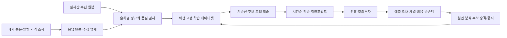

# Historical Data & Feedback Loop 상세 설계 (LLD)

> 상태: 초안 · 2026-10-26
>
> 범위: 과거 시세 확보, 학습 데이터 생성, 모델·전략 평가, 승격과 재학습. 실시간 수집 및 주문 실행은 포함하지 않는다.
>
> 관련 문서: [PRD](../prd/PRD.md) R3·R4·R9 / [HLD](../hld/HLD.md) / [Price Prediction LLD](02-price-prediction.md)

## 1. 목표와 경계

실시간 WebSocket 수집만으로는 학습에 필요한 거래일과 다양한 시장 상황을 빠르게 확보할 수 없다. `price-prediction` 서비스에 **과거 데이터 일괄 수집 작업**을 두고, 요청한 기간의 원본·출처·품질을 기록한다. 예측 모델의 가격 오차와 매매 전략의 비용 반영 순수익을 따로 측정한다. 제품의 최종 목표는 PRD에 정의한 **실전 순수익**이며, 과거·모의 성과는 실전 투입 전 검증 자료다.

## 2. 과거 데이터를 어디서 가져오나

| 필요한 데이터 | 우선 후보 | 사용 조건 |
| --- | --- | --- |
| KRX·NXT 과거 1분봉 | 한국투자증권 `주식일별분봉조회` | 공식 예제의 시장 코드 `J`·`NX`, 날짜·시각 기반 조회를 사용한다. **계좌별 접근, 실제 반환 기간, 장 구간과 NXT 포함 범위는 소량의 읽기 전용 호출로 확인한 뒤 확정**한다. |
| 당일 수신 체결·확정 1분봉 | 기존 `market-data` 기록 | 실시간 재생과 수집 품질 비교에 사용한다. WebSocket 결손은 과거 조회로 조용히 덮어 쓰지 않는다. |
| KRX 일별 가격·공식 종가 대조 | KRX Open API의 일별매매정보, 한투 일별시세 | 공식 종가와 분봉 종가를 구별하고 가격 단위·수정주가 여부를 검증한다. |
| NXT 종료 기준 가격과 오래된 이력 | 한투의 NXT 조회 가능 범위 확인, 필요하면 NXT 데이터 상품 검토 | NXT가 과거 데이터 제공을 별도 신청 대상으로 안내한다. 확인되지 않은 종료 가격을 마지막 체결가로 대체하지 않는다. |

한투 공식 예제는 `inquire-time-dailychartprice`와 **실전 계좌에서 1회 최대 120개 분봉**을 설명한다. 호출당 건수, 과거 조회 범위, 실전·모의 계좌 차이와 호출 한도는 실제 응답과 현재 API 안내를 대조한다. 기간 전체를 한 번에 가져올 수 있다고 가정하지 않는다. KRX Open API는 **일별 데이터** 확인 경로이지 과거 1분봉의 대체 경로가 아니다.

참고: [한투 분봉 조회 예제](https://github.com/koreainvestment/open-trading-api/blob/main/examples_llm/domestic_stock/inquire_time_dailychartprice/inquire_time_dailychartprice.py), [한투 시장 코드 설정](https://github.com/koreainvestment/open-trading-api/blob/main/MCP/Kis%20Trading%20MCP/configs/domestic_stock.json), [KRX Open API 목록](https://openapi.krx.co.kr/contents/OPP/INFO/service/OPPINFO004.cmd), [NXT 데이터 상품](https://portal.nextrade.co.kr/mdclient/member/custom/productOutline.do?menuId=ProdOut)

### 범위와 실행 방식

`HistoricalDataCollector`는 `price-prediction` 서비스 내부의 **요청형 배치 구성 요소**로 둔다. 실시간 예측 소비자와 코드는 함께 관리하되, 실행은 별도 배치 프로세스·모드로 분리한다. 배치 실패나 긴 API 대기가 Redis Stream 소비와 장중 추론을 멈추게 하지 않는다. 입력은 환경, 종목, 시장, 시작·종료 거래일, 제공처, 원주가/수정주가 선택이다. 첫 검증은 삼성전자 한 종목·KRX/NXT 각각 **3~5거래일**로 페이지 순회와 종가 대조를 확인한다. 초기 평가 데이터는 접근 가능한 경우 **60~120거래일**을 목표로 삼고, 서로 다른 시장 상황이 포함되는지 확인한다. 이후 계좌·제공처가 허용하는 범위에서 **약 1년 이상**으로 확장해 재평가한다. 이는 수집·평가 계획이지 모델 성능을 보장하는 최소 표본 수가 아니다. 실제 목표 기간은 조회 가능 범위·품질·전략의 평가 목적을 확인한 뒤 고정한다.

작업은 `(제공처, 종목, 시장, 거래일, 페이지)`별 진행 위치를 남기며, 완료되지 않은 페이지부터 재개한다. 전역 요청 간격과 429·오류 대기를 지키고, 장중 실시간 수집의 접속·할당량을 방해하지 않도록 장후 실행을 기본으로 한다. 같은 응답을 다시 받아도 원본 해시로 중복을 판별한다. 한투 조회가 틱 단위 데이터까지 제공한다고 가정하지 않는다.

## 3. 정규화와 데이터 품질

과거 응답 원본과 수집 명세를 먼저 기록하고, 이후 시장·장 구간·시각이 붙은 공통 분봉으로 변환한다. 모든 행에 `provider`, `venue`, `symbol`, `session`, `barStart`, `fetchedAt`, `sourceHash`, `priceAdjustment`, `quality`를 남긴다. 과거 조회 봉과 실시간 확정 봉은 **출처가 다른 관측값**이므로 동일한 `READY`로 합치지 않는다.

- 시장 달력과 종목별 거래 가능 여부로 예상 구간을 만들되, 거래가 없었던 분과 누락 분을 자동으로 같은 상태로 처리하지 않는다. 제공처의 허봉 포함 옵션도 별도로 기록한다.
- 중복·역순·장 경계·0값·급격한 가격 변화·거래량 단위·수정주가 및 액면분할을 검사한다. 다른 제공처의 값이 다르면 출처별 값을 보존하고 차이를 기록한다.
- 실시간 결손 구간을 과거 데이터로 메워 연구용 데이터셋을 만들 수는 있으나, 해당 행에 `BACKFILLED`와 조회 시각을 붙인다. 과거 실시간 판단에 당시 존재했던 데이터로 취급하지 않는다.
- 미래에 정정된 가격이나 이후에 발표된 공시를 과거 시점의 입력 특징으로 넣지 않는다. 원주가와 수정주가를 혼용하지 않고, 학습·평가에 사용한 가격 정의를 버전에 고정한다.

| 저장 위치 | 내용 |
| --- | --- |
| `data/<환경>/historical/raw/<제공처>/` | API 원본 응답과 요청 범위·응답 시각·해시. 비밀키 제외 |
| `data/<환경>/historical/manifest/` | 요청 범위, 페이지 완료 위치, 누락·충돌·품질 요약 |
| `data/<환경>/research/bars/` | 출처·종목·시장·날짜별 정규화 Parquet |
| `data/<환경>/research/datasets/` | 데이터셋 버전 명세: 사용 기간, 종목, 시장, 출처 해시, 특징·정답 정의와 제외 사유 |

실시간 원본 JSONL은 수정하지 않는다. 연구용 변환 파일은 재생성할 수 있지만, 학습 실행에서 참조한 데이터셋 버전과 해시는 보존한다.

## 4. 학습 및 시간순 평가

1. **정답 정의:** KRX·NXT의 다음 달력상 1분과 정확히 1시간 뒤 1분봉 종가를 시장별로 만든다. KRX 공식 종가와 NXT 종료 기준 가격은 별도 확인된 출처에서만 정답으로 확정한다. 장 경계·결손·미확정 가격은 정답 없음으로 기록한다.
2. **기준선 먼저:** 직전 유효 종가 유지 전략과 단순 거래 전략을 고정한다. 현재 데이터셋에서 이 기준선의 오차와 순손익을 기록한 뒤에만 학습 모델을 비교한다.
3. **후보 모델:** 거래일이 충분히 쌓이면 작은 상태 기반 모델을 후보로 학습한다. 상태는 시장·장 구간별로 초기화하고 결손에서 끊는다. 모델 규모는 메모리와 분당 추론 시간 측정으로 정한다.
4. **시간순 분할:** 거래일 단위로 학습 → 검증 → 최종 시험을 나누고, 목표가 다음 구간에 걸치는 표본을 경계에서 제거한다. 전략 임계값·특징·초매개변수는 검증 구간에서만 선택한다. 최종 시험 구간은 선택이 끝난 뒤 사용한다.
5. **워크포워드:** 과거 구간으로 학습하고 바로 다음 미사용 기간에 예측·전략을 재생하는 과정을 여러 번 반복한다. 각 실행은 데이터셋·코드·모델·정책·비용 가정 버전을 기록한다.

모델 평가는 목표·시장·시간대별 오차, 방향 적중률, 유효 예측률, 지연을 같은 표본의 기준선과 비교한다. **가격 예측 오차 개선을 매매 수익 개선으로 간주하지 않는다.** 매매 전략은 거래 가능 시각, 신호 생성 지연, 수수료·세금·스프레드·체결 미끄러짐을 반영한 순손익, 기준 전략 대비 성과, 거래 횟수·회전율, 최대 낙폭과 손실 한도로 평가한다. 체결 미끄러짐은 가정값과 모의·실제 체결값을 구분한다.

## 5. 성과 기반 피드백 루프

**피드백 주기는 주 1회**다. 한국 시간 기준 한 거래주가 끝나고 그 주의 시세·예측 정답·주문·체결·비용 기록이 확정된 뒤 주간 평가를 실행한다. 누락 기록이 남아 있으면 해당 지표를 미확정으로 표시한다. 매 거래일의 수집 상태 점검과 손실 한도에 따른 즉시 중지는 주간 평가를 기다리지 않는다.

| 시점 | 입력 | 기록·판정 |
| --- | --- | --- |
| 매 거래일 장후 | 새 원본, 예측·실제, 데이터 결손 | 출처별 품질·범위와 평가 가능 여부를 점검한다. |
| 거래주 종료 후 1회 | 고정된 데이터셋, 예측·실제, 판단 스냅샷, 주문·체결·잔고, 비용 | 목표·시장별 예측 오차와 **정책·위험 검사·집행까지 포함한 거래 순수익**을 분리해 주간 보고서에 기록한다. 무거래 대기 판단도 보존한다. |
| 같은 주간 검토 | 기존 운영 버전(champion)과 후보(challenger), 이전 주 보고서 | 동일 기간·비용 조건에서 비교하고, 데이터·예측·판단·체결 중 성과 변화의 원인을 기록한다. 재학습·정책 수정·유지·중지 중 다음 조치를 결정한다. |
| 승격 전 | 미사용 시험 구간, 관찰·모의투자 기록 | 사전에 정한 기간·표본 수·순손익·손실 한도·지연 기준을 모두 확인하고 버전을 고정한다. |
| 운영 중 즉시 | 손실 한도 도달·입력 신뢰성 위반 | 주간 검토를 기다리지 않고 신규 진입을 중지한다. |

주간 보고서에는 평가 기간, 표본 수, 데이터셋·모델·정책 버전, 기준선 대비 예측 성능, 비용 반영 순손익·최대 낙폭, 결손·지연, 전주 대비 변화와 결정 사유를 남긴다. 표본이 부족한 주는 성능 개선을 확정하지 않고 누적 기간과 함께 본다.

재학습 필요성은 주간 검토에서 결정하고 학습은 별도 배치로 수행한다. 결과를 자동으로 운영 모델에 덮어쓰지 않는다. 새 모델은 관찰 → 모의투자 → 제한된 실전 순서로 승격하며, 이전 모델과 정책을 즉시 되돌릴 수 있게 보존한다. 평가 기간·비교 전략·통과 기준은 결과를 보기 전에 정한다. 특정 손실 거래만 골라 재학습하거나 승리한 구간만 재평가하지 않는다.

## 6. 구현 순서와 완료 조건

1. 과거 분봉 API의 KRX·NXT, 날짜 범위, 계좌별 권한, 페이지 순회와 호출 제한을 **소량의 읽기 전용 시험**으로 검증한다. 공식 종가·NXT 종료 가격의 출처를 확인한다.
2. `price-prediction`의 별도 실행 모드에 배치 수집기와 원본·진행 위치·품질 명세를 구현한다. 실시간 데이터와 대조하되 원본을 덮어쓰지 않는다.
3. 버전 고정 데이터셋, 네 목표 유형의 정답, 기준선과 워크포워드 평가를 구현한다.
4. 판단·체결·비용·손익 기록을 연결하고, 모델 성능과 전략 실적을 함께 보여주는 평가 보고서를 만든다.
5. 충분한 거래일을 확보한 뒤 작은 후보 모델을 학습하고 사전 정의한 기준으로 승격 여부를 결정한다.

완료 조건은 같은 원본에서 데이터셋과 평가 결과를 재생성할 수 있고, 데이터 결손·시장 경계·이후 정보가 과거 판단에 섞이지 않으며, 모델 오차 개선 여부와 **비용 반영 순수익 개선 여부를 각각 확인**할 수 있는 것이다.
