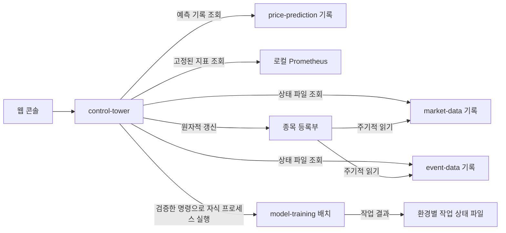

# Control Tower 상세 설계 (LLD)

> 상태: 로컬 콘솔·종목 관리·dev 학습 배치·정보 조회 구현 · 2026-10-26
>
> 관련 문서: [HLD](../hld/HLD.md) / [학습 배치 LLD](04-learning-data-and-feedback.md)

## 경계

브라우저는 `control-tower`가 제공하는 정적 웹 화면과 `/api/*`만 호출한다. `market-data`, `event-data`, `price-prediction`, `model-training`, Prometheus, Grafana에 브라우저가 직접 연결하지 않는다. 컨트롤타워는 환경별 로컬 상태 기록과 Prometheus의 정해진 지표를 읽고, 제한된 요청만 `model-training` 자식 프로세스로 전달한다. 서비스 간 실시간 데이터 전달(Redis Stream)은 이 관리 경로와 독립적이다.

컨트롤타워는 기본적으로 `127.0.0.1:8088`에만 바인딩한다. 현재 개인용 로컬 환경에서는 토큰 없이 웹 화면과 API를 사용한다. 같은 Mac의 다른 프로세스에서도 API에 접근할 수 있으므로 외부 네트워크로 노출하지 않는다. dev와 prd는 별도 프로세스·데이터 경로로 분리한다. 원격 접근이 필요하면 인증 프록시와 접근 정책을 설계한 뒤 추가한다.

## 현재 API

| 경로 | 동작 |
| --- | --- |
| `GET /api/snapshot` | 현재 환경의 서비스 관측값과 최근 학습 작업 20건을 반환한다. 상태 파일의 시각·PID를 확인하며 오래된 기록을 실행 중으로 표시하지 않는다. |
| `GET /api/dashboard?range=1h\|6h\|24h` | Grafana와 같은 시세·사건 지표의 상태값과 시계열을 반환한다. PromQL은 서버의 고정 목록에서만 사용한다. |
| `POST /api/training/jobs` | dev에서 `collect`, `fit`, `promote-dev` 중 하나를 실행한다. 종목·시장·날짜·버전 형식을 검사하고 한 번에 한 작업만 허용한다. |
| `GET /api/symbols` | 환경별 종목 등록부와 개정 번호를 조회한다. |
| `PUT /api/symbols/{symbol}` | dev에서 종목명, KRX/NXT, 뉴스 검색어, DART 기업 고유번호를 등록·수정한다. 요청한 개정 번호가 현재 번호와 다르면 409를 반환한다. |
| `DELETE /api/symbols/{symbol}?revision=N` | dev에서 종목을 비활성화한다. 과거 기록과 등록부 항목은 유지한다. |
| `GET /api/models` | 검증된 후보·활성 모델의 오차와 과거 데이터 확보 기간을 조회한다. |
| `GET /api/information` | OpenDART·연합인포맥스 RSS·GDELT DOC 수집 상태, 최근 사건과 Jev/추가 검색 상태를 조회한다. RSS·점수 항목은 Event Data 구현 후 연결한다. |

종목 등록부는 `data/<환경>/control/watchlist.json`에 원자적으로 교체하고 변경 이력을 `watchlist-audit.jsonl`에 기록한다. 수집기는 같은 환경의 등록부를 약 2초 간격으로 읽는다. 시세 시장 선택은 같은 종목의 YAML 기본값을 덮어쓰며 비활성 항목은 수집 대상에서 빠진다. 시세 수집기는 구독 목록이 바뀌면 WebSocket에 재연결해 적용한다. 새 종목·시장을 장중 추가한 경우 등록 후 **다음 온전한 분**부터 봉을 확정한다. 사건 수집기는 다음 폴링 반복에서 검색어·기업 고유번호를 갱신한다. 빈 검색어·기업 고유번호는 기존 YAML 값을 유지하며, 비활성 항목은 두 제공처의 대상에서 모두 빠진다. 이미 실행 중인 구버전 프로세스에는 새 동작이 적용되지 않으므로 새 코드로 계획된 재시작이 필요하다.

모델 목록은 무결성 검증을 통과한 번들과 활성 포인터를 읽는다. 과거 데이터 확보 현황은 완료 상태의 일별 매니페스트만 센다. 정보 화면은 수집 상태 파일과 최근 사건 기록을 읽는 조회 기능이다. 학습 실행은 기존 dev 전용 배치 경로를 사용한다.

웹 대시보드는 시세 수집기 실행·재시작·KRX/NXT 장중 지연, 사건 수집기 실행·DART 마지막 성공·발견·실패를 상태 카드로 보여준다. 시계열은 시장별 프레임/초, 봉 품질, 결손, 오류, 제공처별 조회, 새 사건과 제한 응답이다. 범위는 최근 1·6·24시간 중 선택하며 15초마다 새로 조회한다. Prometheus가 닿지 않으면 지표를 0으로 바꾸지 않고 사용 불가로 표시한다. Grafana는 상세 탐색용으로 계속 사용할 수 있다. 로컬 Prometheus 주소는 `control.prometheus-url`로 설정하며 루프백 HTTP만 허용한다.

상태 조회는 기록 기반이다. 사건 수집기는 `health.json`의 PID와 갱신 시각으로 실행 여부를 확인한다. 시세는 당일 감독 상태 파일을 읽고, 예측기는 당일 출력 파일의 최근 수정 시각을 표시한다. 시세·예측의 기록이 있다고 프로세스가 실행 중이라고 단정하지 않는다. 향후 각 서비스가 내부 관리 인터페이스를 제공하면 컨트롤타워의 어댑터에서만 연결하고, 브라우저용 서비스 주소는 공개하지 않는다.

학습 작업은 셸 없이 검증한 인자로 `model-training` JAR를 실행한다. 컨트롤타워는 자식 프로세스에 학습용 한투 키만 전달하고, 작업 ID·시작/종료 시각·종료 코드를 `data/<환경>/control/jobs/`에 남긴다. 자식 출력은 같은 경로의 로그 파일에 보관하고 API 응답에 포함하지 않는다. 컨트롤타워가 작업 도중 종료되면 배치는 독립적으로 계속될 수 있으며, 재기동 후 종료 코드를 회수할 수 없는 작업은 `UNKNOWN_RESULT`로 표시한다. 해당 경우 산출물과 로그를 확인해야 한다.

현재 UI는 prd 승격, 주문, 상주 서비스 시작·중지를 제공하지 않는다. 이러한 명령을 추가할 때는 각 서비스의 안전한 제어 계약과 별도 권한·감사 기록을 먼저 정의한다.
