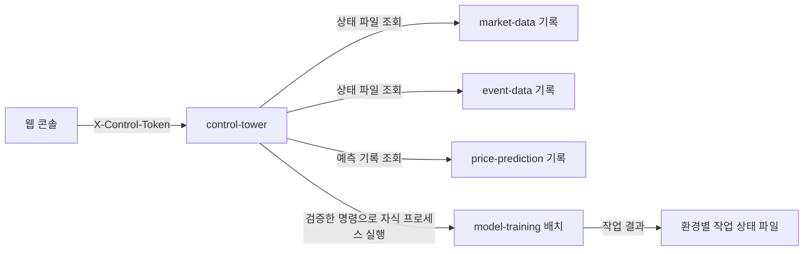

# Control Tower 상세 설계 (LLD)

> 상태: 로컬 콘솔·dev 학습 배치 제어 1차 구현 · 2026-10-26
>
> 관련 문서: [HLD](../hld/HLD.md) / [학습 배치 LLD](04-learning-data-and-feedback.md)

## 경계

브라우저는 `control-tower`가 제공하는 정적 웹 화면과 `/api/*`만 호출한다. `market-data`, `event-data`, `price-prediction`, `model-training`에 브라우저가 직접 연결하지 않는다. 컨트롤타워는 환경별 로컬 상태 기록을 읽고, 제한된 요청만 `model-training` 자식 프로세스로 전달한다. 서비스 간 실시간 데이터 전달(Redis Stream)은 이 관리 경로와 독립적이다.

컨트롤타워는 기본적으로 `127.0.0.1:8088`에만 바인딩한다. API에는 32자 이상의 운영 토큰을 `X-Control-Token` 헤더로 요구한다. 웹 화면은 토큰을 현재 탭의 메모리에만 보관하고 다른 서비스 주소를 알지 않는다. dev와 prd는 별도 프로세스·토큰·데이터 경로로 분리한다. 원격 접근이 필요하면 별도의 인증 프록시와 접근 정책을 설계한 뒤 추가한다.

## 현재 API

| 경로 | 동작 |
| --- | --- |
| `GET /api/snapshot` | 현재 환경의 서비스 관측값과 최근 학습 작업 20건을 반환한다. 상태 파일의 시각·PID를 확인하며 오래된 기록을 실행 중으로 표시하지 않는다. |
| `POST /api/training/jobs` | dev에서 `collect`, `fit`, `promote-dev` 중 하나를 실행한다. 종목·시장·날짜·버전 형식을 검사하고 한 번에 한 작업만 허용한다. |

상태 조회는 기록 기반이다. 사건 수집기는 `health.json`의 PID와 갱신 시각으로 실행 여부를 확인한다. 시세는 당일 감독 상태 파일을 읽고, 예측기는 당일 출력 파일의 최근 수정 시각을 표시한다. 시세·예측의 기록이 있다고 프로세스가 실행 중이라고 단정하지 않는다. 향후 각 서비스가 내부 관리 인터페이스를 제공하면 컨트롤타워의 어댑터에서만 연결하고, 브라우저용 서비스 주소는 공개하지 않는다.

학습 작업은 셸 없이 검증한 인자로 `model-training` JAR를 실행한다. 컨트롤타워는 자식 프로세스에 학습용 한투 키만 전달하고, 작업 ID·시작/종료 시각·종료 코드를 `data/<환경>/control/jobs/`에 남긴다. 자식 출력은 같은 경로의 로그 파일에 보관하고 API 응답에 포함하지 않는다. 컨트롤타워가 작업 도중 종료되면 배치는 독립적으로 계속될 수 있으며, 재기동 후 종료 코드를 회수할 수 없는 작업은 `UNKNOWN_RESULT`로 표시한다. 해당 경우 산출물과 로그를 확인해야 한다.

현재 UI는 prd 승격, 주문, 상주 서비스 시작·중지를 제공하지 않는다. 이러한 명령을 추가할 때는 각 서비스의 안전한 제어 계약과 별도 권한·감사 기록을 먼저 정의한다.
